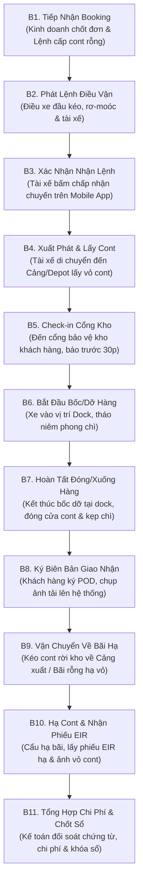
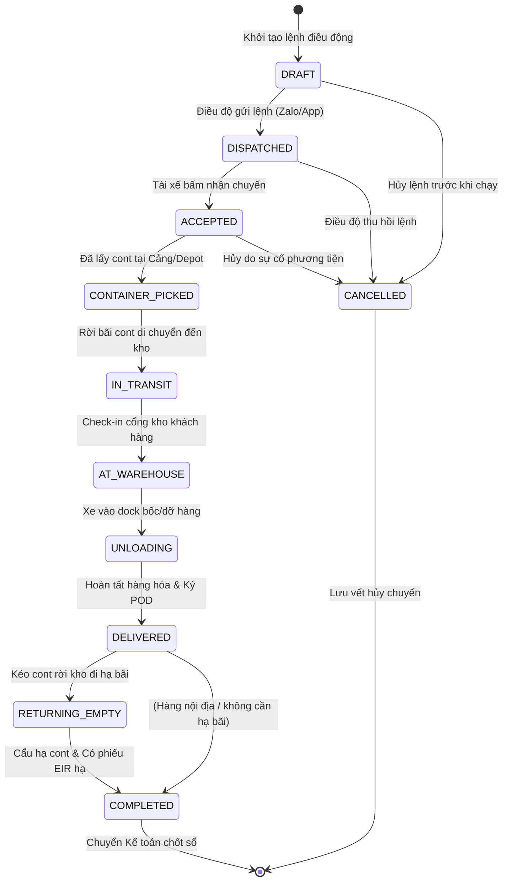
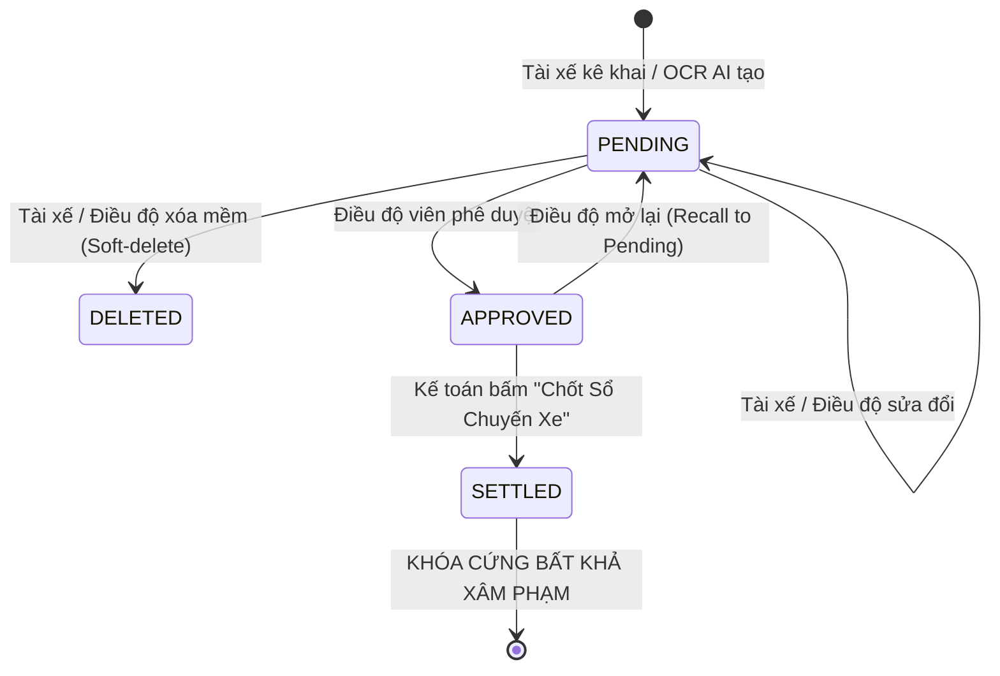

# GSS LOGISTICS — OPERATIONAL WORKFLOW & EXPENSE LIFECYCLE ARCHITECTURE
## Quy Trình Điều Vận 11 Bước, Máy Trạng Thái Chuyến Xe & Vòng Đời Chi Phí Kế Toán

> **Hệ thống:** GSS Logistics Platform (TMS, WMS & Financial Subsystem)  
> **Phiên bản:** v4.7.19 | **Cập nhật lần cuối:** 01/11/2026  
> **Áp dụng:** Phòng Điều vận, Đội ngũ Lái xe, Phòng Kế toán - Tài chính & Ban Giám Đốc GSS  
> **Tiêu chuẩn:** ISO/IEC/IEEE 42010, Mẫu S03a-DN (Bộ Tài Chính) & Arc42 Section 6 (Runtime Architecture)

---

## 1. QUY TRÌNH ĐIỀU VẬN 11 BƯỚC THỰC TẾ (11-STEP LOGISTICS WORKFLOW)

---

## 1.1 KIẾN TRÚC MÃ CHỨNG TỪ 3 CẤP (3-TIER TMS DOCUMENT HIERARCHY)

Để phục vụ quản lý chuỗi cung ứng chặt chẽ từ Sales đến Điều vận nội bộ, Nhà xe thầu phụ (Vendor) và Lái xe hiện trường, hệ thống chuẩn hóa 3 cấp mã phiếu độc lập:

1. **`BK.yyMM.xxx` (Đơn Đặt Chỗ / Booking Khách Hàng):**
   - Sinh ra khi Phòng Kinh doanh chốt đơn hàng và nhập vào hệ thống.
   - Thể hiện nhu cầu vận chuyển tổng thể của lô hàng (chưa có phương tiện).
   - Tại Tab 1 Điều vận, những đơn chưa phân bổ hoặc đang điều dở dang được giữ nguyên mã `BK.yyMM.xxx` kèm huy hiệu `CHỜ ĐIỀU ĐỘ`.
2. **`LDD.BK.yyMM.xxx` (Lệnh Điều Động Lô Hàng):**
   - Kích hoạt khi Điều vận hoàn tất phân bổ toàn bộ container cho các Nhà xe và phát lệnh.
   - Tại Tab 1 Điều vận, mã tự động gắn tiền tố `LDD.` kèm huy hiệu `ĐÃ ĐIỀU ĐỘ`.
3. **`VC.yyMM.xxx` (Phiếu Vận Chuyển / Vận Đơn Chuyến Xe Lăn Bánh):**
   - **Chỉ được sinh ra ngay khi Container được gán cụ thể Đầu kéo + Rơ-moóc + Tài xế** (do Nhà xe khai báo trên Cổng Vendor Portal hoặc Điều vận chỉ định).
   - Nếu container chưa được gán tài xế & đầu kéo, hệ thống hiển thị trạng thái `Chờ Vendor gán xe` và **chưa sinh mã VC**.
   - Tại Tab 3, hệ thống giám sát hành trình các xe lăn bánh trên tuyến theo từng Phiếu VC.

---

## 2. MÁY TRẠNG THÁI CHUYẾN XE (TRIP STATE MACHINE)

Vòng đời chuyến xe được kiểm soát bằng máy trạng thái đơn định (Deterministic State Machine) tại `core.workflows`, đảm bảo **không có tình trạng nhảy cóc trạng thái trái quy luật vận tải**:

### Bảng Ma Trận Chuyển Trạng Thái & Phân Quyền (RBAC Transitions):

| Trạng thái Hiện tại | Trạng thái Cho phép | Tác nhân kích hoạt | Điều kiện tiên quyết bắt buộc (Guard Conditions) |
|---|---|---|---|
| `DRAFT` | `DISPATCHED` | Điều Phối Viên | Đã gán Xe (`vehicle`), Tài xế (`driver` hoặc `subcontractor`) và Lộ trình. |
| `DRAFT` | `CANCELLED` | Điều Phối Viên | Nhập lý do hủy lệnh điều động. |
| `DISPATCHED` | `ACCEPTED` | Tài Xế Hiện Trường | Tài xế bấm "Xác nhận nhận chuyến" trên ứng dụng di động. |
| `ACCEPTED` | `CONTAINER_PICKED` | Tài Xế / Điều Độ | Đã cập nhật số Container, số Seal và chụp ảnh phiếu EIR lấy cont. |
| `CONTAINER_PICKED` | `IN_TRANSIT` | Tài Xế | Bắt đầu lăn bánh di chuyển theo tuyến đường quy định. |
| `IN_TRANSIT` | `AT_WAREHOUSE` | Tài Xế | GPS xác thực gần kho khách hàng hoặc bấm "Đã đến cổng kho". |
| `AT_WAREHOUSE` | `UNLOADING` | Tài Xế | Xe đã vào Dock, bắt đầu bấm giờ xếp dỡ hàng hóa. |
| `UNLOADING` | `DELIVERED` | Tài Xế | Đã hoàn tất bốc dỡ, tải ảnh biên bản bàn giao POD có chữ ký khách hàng. |
| `DELIVERED` | `RETURNING_EMPTY` | Tài Xế | Kéo vỏ cont rỗng rời kho về bãi hạ quy định. |
| `RETURNING_EMPTY` | `COMPLETED` | Tài Xế / Điều Độ | Tải lên phiếu EIR hạ vỏ cont hoặc chứng từ bàn giao cảng xuất. |
| Bất kỳ (trừ `COMPLETED`) | `CANCELLED` | Ban Giám Đốc / Điều Độ | Bắt buộc ghi rõ lý do hủy và cập nhật nhật ký Audit Trail. |

---

## 3. CÁC QUY TRÌNH LOGISTICS ĐẶC THÙ (SPECIALIZED LOGISTICS WORKFLOWS)

### 3.1 Nghiệp Vụ Cắt Kéo / Cắt Moóc (Drop & Hook — 2 Chặng)
- **Bản chất nghiệp vụ:** Xe đầu kéo 1 kéo rơ-moóc mang cont đến kho khách hàng, để lại rơ-moóc tại kho để công nhân bốc dỡ dần (Uncoupling). Đầu kéo 1 rời đi nhận chuyến khác. Sau khi xếp dỡ xong, đầu kéo 2 (hoặc chính đầu kéo 1) đến móc lại moóc (Coupling) kéo đi hạ bãi.
- **Kiểm soát hệ thống:**
  * Cờ `is_split_trip = True`.
  * Quản lý riêng: `driver` (Tài xế chặng 1 - Lấy cont đưa vào kho) và `dropoff_driver` (Tài xế chặng 2 - Kéo cont ra hạ bãi).
  * Tỷ lệ phân chia lương chuyến: `driver_split_ratio` (Mặc định 50% - 50% hoặc 60% - 40% tùy tuyến).
  * Phụ cấp cắt moóc riêng biệt: `driver_allowance` và `dropoff_driver_allowance`.

### 3.2 Nghiệp Vụ Chở Ghép 2 Container 20ft (Twin 20ft Drayage / Kẹp 20)
- **Bản chất nghiệp vụ:** 1 đầu kéo + 1 rơ-moóc xương 40ft chở đồng thời 2 container 20ft cùng lúc để tối ưu hóa năng suất nhiên liệu và cước vận tải.
- **Kiểm soát hệ thống:**
  * Cờ `is_twin_container = True`.
  * Quản trị 2 bộ số liệu song song: Cont 1 (`container_number`, `seal_number`, `booking_or_bill`, `vgm_weight`) và Cont 2 (`container_number_2`, `seal_number_2`, `booking_or_bill_2`, `vgm_weight_2`).
  * Định mức cước và lương chuyến tự động nhân hệ số ghép cont.

### 3.3 Hệ Thống Cảnh Báo Quá Hạn Vỏ Cont (DEM/DET Watchdog Engine)
- **Cơ chế:** Tự động tính toán số ngày miễn phí lưu bãi (**Free Demurrage**) và miễn phí lưu vỏ cont (**Free Detention**) dựa trên ngày lấy cont thực tế:
  * 🟢 **Màu Xanh (An Toàn):** Còn hạn Free-time $> 48$ giờ.
  * 🟡 **Màu Vàng (Cảnh Báo):** Còn hạn Free-time $\le 24$ giờ $\rightarrow$ Đẩy cảnh báo lên bảng điều vận ưu tiên xếp xe hạ vỏ.
  * 🔴 **Màu Đỏ (Khẩn Cấp):** Quá hạn Free-time $\rightarrow$ Tự động đếm ngày trễ và ước tính tiền phạt hãng tàu (\$20 - \$80/ngày/cont).

---

## 4. VÒNG ĐỜI 3 GIAI ĐOẠN CỦA KHOẢN CHI PHÍ (EXPENSE STATE MACHINE)

Tại Bước 11 của chu trình vận hành, toàn bộ chi phí phát sinh hiện trường (`TripExpense`) trải qua 3 giai đoạn được kiểm soát chặt chẽ:

### Chi Tiết Phân Quyền Theo 3 Cấp Độ:
1. **Giai đoạn 1: Chờ Duyệt (`PENDING`) — Tự do hiệu chỉnh:**
   - **Tài xế:** Được phép sửa số tiền, đổi danh mục, cập nhật ghi chú hoặc xóa mềm khoản chi do mình vừa nhập sai.
   - **Điều độ viên:** Được phép chỉnh sửa số tiền, chuẩn hóa lại danh mục, hoặc bấm Duyệt (`APPROVED`) / Từ chối.
2. **Giai đoạn 2: Điều Độ Đã Duyệt (`APPROVED`) — Kiểm soát thay đổi:**
   - Khoản chi đã được Điều phối viên xác nhận và chính thức đưa vào số liệu P&L tạm tính của chuyến xe.
   - **Tài xế:** KHÔNG ĐƯỢC tự ý xóa hay sửa. Nếu phát hiện sai sót, tài xế phải liên hệ Điều độ viên yêu cầu mở lại.
   - **Điều độ viên:** Có quyền mở lại (`Recall to Pending`) hoặc điều chỉnh số tiền khi đối soát lại hóa đơn gốc.
3. **Giai đoạn 3: Kế Toán Đã Chốt Sổ (`SETTLED` / `LOCKED`) — Bất khả xâm phạm:**
   - Kế toán viên bấm **"Chốt Sổ Chi Phí Chuyến Xe"**.
   - **Nguyên tắc bất biến:**
     * Toàn bộ bảng kê chi phí chuyển sang trạng thái `SETTLED` và bị **KHÓA CỨNG (READ-ONLY)**.
     * Không một ai (kể cả Tài xế, Điều độ viên hay Admin) được phép sửa hoặc xóa các dòng chi phí này.
     * Mọi nút Sửa/Xóa bị vô hiệu hóa hoàn toàn; hiển thị biểu tượng 🔒 Khóa sổ kèm tên Kế toán viên và ngày giờ chốt số.
     * Mọi phát sinh tài chính sau khi khóa sổ phải lập bút toán điều chỉnh riêng (`ExpenseAdjustment`), tuyệt đối không sửa đổi bảng kê lịch sử.

---

## 5. BẢNG KÊ 8 KHOẢN MỤC CHI PHÍ & 3 DÒNG PHÂN LOẠI CHI TRẢ

### 5.1 Danh Mục 8 Khoản Mục Chi Phí Hiện Trường
| STT | Khoản mục Chi phí | Mã Category | Mục đích & Ràng buộc chứng từ |
|:---:|---|---|---|
| **1** | **Phí Nâng Cont** | `LIFT_ON` | Cảng/Depot nâng cont lên rơ-moóc; bắt buộc có mã tra cứu HĐĐT. |
| **2** | **Phí Hạ Cont** | `LIFT_OFF` | Cảng/Depot cẩu hạ cont xuống bãi; bắt buộc có mã tra cứu HĐĐT. |
| **3** | **Vé Cầu Đường / BOT / ETC** | `TOLL` | Trạm thu phí đường bộ; đối chiếu biểu phí theo tuyến đường. |
| **4** | **Cược Vỏ Cont Hãng Tàu** | `DEPOSIT` | Tiền cọc vỏ cont; hoàn ứng 100% khi trả vỏ cont nguyên vẹn. |
| **5** | **Phí Cân Xe / Cân Hàng** | `WEIGHING` | Cân tải trọng tại trạm cân/kho; đính kèm phiếu cân. |
| **6** | **Bồi Dưỡng Bốc Xếp / Kho** | `LABOR` | Bồi dưỡng công nhân bốc dỡ tại dock kho khách hàng. |
| **7** | **Chi Hộ Khách Hàng (OBH)** | `EINVOICE` | Tiền cước hãng tàu/phí cảng thanh toán hộ chủ hàng; thu lại qua Debit Note. |
| **8** | **Chi Phí Khác** | `OTHER` | Vá lốp khẩn cấp, rửa vỏ cont bẩn, bảo quản nhiệt độ cont lạnh. |

### 5.2 Ba Dòng Phân Loại Chi Trả (`expense_payer_type`)
1. **`COMPANY_COST` (Chi Phí Nội Bộ GSS):** Chi phí phục vụ vận hành do GSS chịu. Được trừ vào doanh thu để tính Lợi nhuận gộp P&L của chuyến xe.
2. **`COMPANY_OBH` (GSS Chi Hộ Khách Hàng — On Behalf of Customer):** Tiền GSS ứng trước cho chủ hàng. Gom vào **Bảng Kê Chi Hộ (Debit Note)** để thu lại 100%, không tính vào P&L chuyến xe.
3. **`SUB_OBH` (Chi Hộ Xe Bạn / Thầu Phụ 3PL):** Tiền tài xế nộp hộ cho xe thuê ngoài 3PL. Được cấn trừ khi lập Bảng Kê Quyết Toán Công Nợ Thầu Phụ (`SubcontractorSettlement`).

---

## 6. QUẢN TRỊ DÒNG TIỀN SỔ QUỸ S03a-DN & TẠM ỨNG 2 CẤP

### 6.1 Cơ Chế Tạm Ứng 2 Cấp Độ (Two-Tier Advance Mechanism)
- **Cấp 1 — Quỹ Tạm Ứng Điều Vận (`DispatcherAdvanceFund`):** Kế toán xuất quỹ tiền mặt/ngân hàng cấp hạn mức quỹ lưu động cho Trưởng phòng Điều vận.
- **Cấp 2 — Tạm Ứng Chuyến Xe Tài Xế (`DriverTripAdvance`):** Điều phối viên trích từ Quỹ Điều Vận để cấp tạm ứng cho tài xế trước mỗi chuyến đi. Khi chuyến hoàn tất, số tiền thực chi hợp lệ được đối soát hoàn ứng và tất toán vào quỹ.

### 6.2 Sổ Quỹ Thu - Chi Mẫu S03a-DN (`CashTransaction`)
Hệ thống hạch toán dòng tiền minh bạch theo chuẩn kế toán Việt Nam (Thông tư 200/2014/TT-BTC & 133/2016/TT-BTC):
- Thu cước khách hàng, Thu hoàn ứng Debit Note.
- Chi tạm ứng điều vận, Chi thanh toán thầu phụ 3PL, Chi nạp tài khoản ETC/ePass.
- Quản lý tách bạch giữa: **Tồn Quỹ Tiền Mặt tại Két** và **Số Dư Tài Khoản Ngân Hàng**.

---

## 7. NGUYÊN TẮC ZERO VARIANCE FINANCIAL AUDIT

1. **Công thức P&L Bất Biến:**
   $$\text{Lợi Nhuận Gộp Chuyến (Profit)} = \text{Doanh Thu Cước (Revenue)} - \sum \text{Chi Phí Hợp Lệ (COMPANY\_COST)}$$
   $$\text{Tỷ Suất Lợi Nhuận (Margin \%)} = \frac{\text{Lợi Nhuận Gộp}}{\text{Doanh Thu Cước}} \times 100\%$$
2. **Cập Nhật Tự Động Qua Signals:**
   Mỗi khi bản ghi `TripExpense` được phê duyệt hoặc chốt sổ, hàm `update_financials()` trên `DispatchTrip` tự động kích hoạt tính toán lại và lưu vào các trường cache (`cached_revenue`, `cached_expense`, `cached_profit`, `cached_margin_percent`), triệt tiêu hoàn toàn sai lệch số liệu giữa bảng kê và báo cáo tổng hợp.
