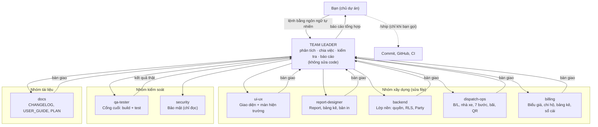

# ĐỘI AI GSS TMS — Sơ đồ tổ chức và cách dùng

> Dành cho người mới vào dự án và cho chính các AI agent. Quy tắc gốc ở [`CLAUDE.md`](../CLAUDE.md); việc dở ở [`12-backlog.md`](12-backlog.md).
> Cấu hình thật nằm trong `.claude/agents/` (9 file) và `.claude/skills/` (10 skill). Tài liệu này mô tả, file cấu hình mới là nguồn chạy.
> Dựng ngày 09/11/2026 theo mẫu đội AI của BIM Logistics (`E:\Bim_Logistics\docs\agent-team.md`), hiệu chỉnh cho mô hình GSS.

## 1. Nguyên tắc

- Bạn chỉ nói chuyện với **một người: Team Leader**. Team Leader không tự sửa code: phân tích, giao việc, kiểm tra, báo cáo.
- Mỗi subagent làm **một chuyên môn**, có vùng file riêng, trả kết quả theo **mẫu bàn giao cố định**.
- Cuối mỗi lần làm việc: việc xong ghi `docs/03-features.md`, việc chưa xong ghi `docs/12-backlog.md`; đầu phiên mới đọc `docs/12-backlog.md`.
- Không ai được báo "xong" thay `qa-tester`. Chỉ `/ship` mới commit/đưa code lên GitHub, và chỉ khi bạn gọi.

## 2. Khác gì so với đội BIM Logistics

| Điểm | BIM Logistics | GSS TMS | Lý do |
|---|---|---|---|
| Nghiệp vụ điều vận | gộp trong `backend` | tách **`dispatch-ops`** | GSS lấy B/L + cont + nhà xe làm trung tâm (MBL/HBL, Vendor Link, máy 7 bước + chứng từ, chặng/lượt xe, bãi, QR) – vùng lõi, nhiều quy tắc riêng |
| `backend` | toàn bộ `apps/**` trừ tiền | **lớp nền**: `core`, `master_data` (Party), `documents`, quyền, RLS, `public_id` | Lớp nền dùng chung với repo gốc, bản vá phải ghi `PLATFORM_PATCHES.md` |
| Tiền | `accounting` (tạm ứng 2 cấp, sổ quỹ, quyết toán tài xế) | **`billing`** (biểu giá, JobCharge/JobCost, chi hộ, claim, bảng kê, hóa đơn, sổ cái) | GSS làm với nhà xe thuê ngoài; phần tạm ứng/quỹ kiểu BIM đang chờ dọn |
| Cách ly dữ liệu | lọc tenant | lọc ORM **+ Row-Level Security** | Skill mới **`tenant-check`**, dùng bởi backend, dispatch-ops, billing, qa-tester, security |
| Cổng kiểm thử | `qa.py` dùng CSDL dev | `qa.py` tự dựng **Postgres tạm cổng 5438**, chặn cổng 5436 của stack 8086 | GSS chỉ có một cách chạy (Docker 8086); test không được đụng CSDL đó |
| Ship | push `master` → CI → Deploy VPS → kiểm production | commit cục bộ; push chỉ khi bạn yêu cầu (lần đầu ghi đè `GSS_LOGISTICs`); chưa deploy | Chưa có remote, VPS, domain |
| Tài liệu | tên thường (`docs/features.md`…) | tên IN HOA (`docs/03-features.md`, `04-user-guide.md`…) + `12-backlog.md` mới | Giữ quy ước sẵn có của repo GSS |

## 3. Sơ đồ tổ chức



Bản chữ:

```text
Bạn
 └─ TEAM LEADER (team-leader)
     ├─ Nhóm xây dựng : ui-ux · report-designer · backend · dispatch-ops · billing
     ├─ Nhóm kiểm soát: qa-tester (cổng cuối) · security (chỉ đọc)
     └─ Nhóm tài liệu : docs
```

## 4. Chức năng từng thành viên

| Thành viên | Làm gì | Nhận khi lệnh nói về | Vùng chính | Skill nạp sẵn | Quyền |
|---|---|---|---|---|---|
| **team-leader** | Hiểu lệnh, tách việc, chọn người, song song/tuần tự, đối chiếu bàn giao với `git diff`, báo cáo | Mọi lệnh | Không sửa file | — | Đọc, `Bash`, hỏi bạn, gọi 8 subagent |
| **ui-ux** | Rà soát/chỉnh giao diện theo design system; màn hiện trường nhà xe, tài xế, khách | "rà soát UI", "chỉnh màn hình", "cổng nhà xe", "trang QR" | `templates/**`, `static/js/src/app/**` (phần giao diện) | `ui-review` | Sửa file |
| **report-designer** | Report, bảng kê cước/chi hộ, lệnh điều vận, biên bản giao hàng, xuất Excel, dashboard nhà xe | "lập report", "mẫu in", "bảng kê", "biên bản" | `static/js/src/app/reports/**`, `reports_api.py`, `finance_reports_api.py`, bản in trong `apps/gss/api.py` | `new-report`, `ui-review` | Sửa file |
| **backend** | Lớp nền: model dùng chung, quyền, tenant/RLS, `public_id`, audit, Party, kho chứng từ | "quyền", "vai trò", "đối tác", "đa doanh nghiệp", "màn hình mới" | `core/**`, `apps/master_data`, `apps/documents`, `config/**` | `model-change`, `new-screen`, `tenant-check` | Sửa file |
| **dispatch-ops** | Nghiệp vụ điều vận: B/L MBL/HBL, phân bổ nhà xe, Vendor Link, 7 bước + chứng từ, đổi cont, street-turn, chặng/lượt xe, DEM/DET, bãi, QR, hải quan | "B/L", "cont", "nhà xe", "tài xế", "trạng thái", "hạ rỗng", "bãi", "DEM/DET" | `apps/gss/**` (trừ tiền), `apps/dispatch/gss_*`, `vendor_*`, `depot_yard`, `qr_tracking`, `customs`, `fleet`, `exceptions` | `model-change`, `tenant-check` | Sửa file |
| **billing** | Mọi thứ chạm tiền | "biểu giá", "cước", "chi hộ", "nâng hạ", "bảng kê", "hóa đơn", "công nợ" | `apps/gss/pricing.py`, `claims.py`, `statements.py`, `apps/billing`, `apps/ledger` | `billing-check`, `model-change`, `tenant-check` | Sửa file |
| **qa-tester** | Build, `qa.py verify/audit`, test, hồi quy, xem trình duyệt trên 8086 | Luôn là bước cuối; "kiểm thử", "audit" | Test, lệnh | `audit`, `tenant-check` | Sửa **test**, chạy lệnh |
| **security** | Quyền, IDOR, cách ly công ty, token/link công khai, upload, PII tài xế | "bảo mật", endpoint/link mới, trước phát hành | Toàn repo, chỉ đọc | `audit`, `tenant-check` | Chỉ đọc |
| **docs** | CHANGELOG (kèm Giữ nguyên), USER_GUIDE + `/helps`, FEATURES, API/DB docs, `PLATFORM_PATCHES.md`, ghi sổ PLAN | Sau mọi thay đổi đổi hành vi | `docs/**`, `PLATFORM_PATCHES.md`, `templates/help.html` (sinh) | `docs-sync` | Sửa tài liệu |

Mỗi thành viên có mục **"Không được"** trong file riêng (ví dụ `dispatch-ops` không đổi số tiền, `billing` không chạy `rebuild_ledger` trên CSDL 8086, `backend` không tắt RLS để "cho chạy được").

## 5. Skill (quy trình dùng chung)

| Skill | Mục đích | Ai dùng chính |
|---|---|---|
| `refactor` | Vòng chuẩn cho mọi yêu cầu sửa code: baseline → sửa đúng phạm vi → build → verify → báo cáo | Phiên chính khi lệnh nhỏ |
| `audit` | `qa.py audit`: chức năng + bảo mật + giao diện + tài liệu, phân FAIL/WARN/INFO/SKIP | qa-tester, security |
| `ship` | verify → commit → (push khi được yêu cầu) → theo dõi CI. **Chỉ chạy khi bạn gọi** | Bạn gọi `/ship` |
| `docs-sync` | Đồng bộ tài liệu với thay đổi, ghi sổ PLAN/FEATURES | docs |
| `ui-review` | Checklist UI/UX + chuẩn hiện trường | ui-ux, report-designer |
| `new-report` | Đủ điểm nối một report: API, quyền `REPORTS`, lọc công ty, JS, in, test | report-designer |
| `new-screen` | Màn hình/tab/modal mới hoặc trang công khai dùng token | backend |
| `model-change` | Đổi model/migration an toàn (company, RLS, public_id, Party) | backend, dispatch-ops, billing |
| `billing-check` | Đối chiếu số trước/sau, tổng bảng kê, nợ = có (chỉ đọc) | billing |
| `tenant-check` | Cách ly công ty + mã công khai + token | backend, dispatch-ops, billing, qa-tester, security |

Công cụ chung: `python scripts/qa.py verify|audit`, `scripts/build_app_js.py`, `scripts/build_css.py`, `scripts/build_help_page.py`.

## 6. Lệnh nào đi đâu

| Nội dung lệnh | Giao cho | Ghi chú |
|---|---|---|
| Rà soát/chỉnh UI một màn hình, cổng nhà xe, trang QR | ui-ux | Chỉ đọc thì song song được |
| Report, mẫu in, bảng kê, biên bản giao hàng | report-designer | Cần API/field mới → dispatch-ops/billing/backend trước |
| B/L, cont, phân bổ nhà xe, trạng thái, chứng từ, bãi, QR, DEM/DET | dispatch-ops | Thiếu quy tắc nghiệp vụ → dừng, hỏi bạn |
| Bất cứ thứ gì liên quan tiền | billing | Thiếu công thức → dừng, hỏi bạn |
| Quyền, vai trò, đối tác, đa doanh nghiệp, model dùng chung, màn hình mới | backend | Màn hình xong → ui-ux rà lại nếu yêu cầu |
| "Kiểm tra toàn diện", "audit" | qa-tester + security (song song) | Chỉ đọc, báo cáo cảnh báo |
| "Commit / đưa lên GitHub" | Không giao subagent | Bạn gọi `/ship` |
| Lệnh một chuyên môn, nhỏ | Phiên chính tự làm theo `refactor` | Khỏi dựng cả đội |

## 7. Một lệnh chạy thế nào

```text
1  Team Leader đọc PLAN, hiểu lệnh; mơ hồ hoặc thiếu quy tắc nghiệp vụ -> hỏi bạn
2  Baseline: git status + qa.py verify --fast (ghi lỗi có sẵn)
3  Lập kế hoạch: ai làm gì, song song hay tuần tự
4  Giao việc (prompt tự đủ ý) -> subagent làm -> trả BÀN GIAO
5  Team Leader đối chiếu bàn giao với git diff; sai phạm vi thì trả lại
6  qa-tester chạy build + verify (đỏ thì quay về đúng người gây lỗi); link/endpoint mới -> security
7  docs đồng bộ tài liệu + GHI SỔ: việc xong -> 03-features.md, việc dở -> 12-backlog.md
8  Báo cáo cho bạn (nêu mục đã ghi vào PLAN)
```

**Ví dụ:** "Thêm phí lưu bãi vào bảng kê khách và hiện trên cổng nhà xe"
1. `dispatch-ops` xác nhận dữ liệu ngày vào/ra bãi (`depot_yard`) đủ để tính; thiếu quy tắc tính ngày → TỒN ĐỌNG → Team Leader hỏi bạn.
2. `billing` thêm mã phí + áp giá + dòng bảng kê, test số liệu (`billing-check`).
3. `report-designer` thêm cột vào bảng kê in; `ui-ux` hiển thị trên cổng nhà xe (nếu nhà xe được xem phí – hỏi trước).
4. Các bước ghi file nối tiếp nhau nên **tuần tự**; `security` rà link nhà xe (song song với bước 3 vì chỉ đọc).
5. `qa-tester` chạy `qa.py verify --full`; `docs` cập nhật USER_GUIDE + CHANGELOG + PLAN.

**Mẫu bàn giao** (mọi subagent phải trả):

```text
KẾT QUẢ: Hoàn thành | Hoàn thành một phần | Bị chặn
ĐÃ ĐỔI: <file> - <một dòng mỗi file>
ĐÃ KIỂM: <lệnh/cách kiểm> -> <kết quả>
GIỮ NGUYÊN: <hành vi/hợp đồng cố ý không đổi>
TỒN ĐỌNG / RỦI RO: <việc ngoài phạm vi, lỗi có sẵn, chưa kiểm được, câu hỏi cho người dùng>
```

## 8. Quy tắc phối hợp

- **Chỉ đọc chạy song song; ghi file cùng vùng chạy tuần tự.** Hai agent sửa cùng file là nguồn lỗi chính. `apps/gss/models.py` có cả model điều vận lẫn model tiền: `dispatch-ops` và `billing` không bao giờ sửa song song.
- **Không dùng `isolation: worktree`:** worktree tách từ nhánh gốc nên không thấy thay đổi chưa commit, và `app.js`/`tailwind*.css` là file sinh dễ xung đột khi gộp.
- Subagent **không thấy hội thoại** với bạn: lời giao việc phải tự đủ ý.
- Subagent **có đọc `CLAUDE.md`**; mục "Điều phối" của file đó chia rõ vai phiên chính và vai subagent. Subagent không tự điều phối, không gọi thêm subagent.
- Việc chạm tiền, migration phá hủy, push, thao tác trên CSDL stack 8086, khởi động lại stack khi có migration mới: hỏi bạn trước.

## 9. Cách chạy đội

| Cách | Lệnh | Khi nào |
|---|---|---|
| Phiên thường | Cứ ra lệnh | Hằng ngày; `CLAUDE.md` mục "Điều phối" khiến phiên chính làm vai Team Leader |
| Ép làm Team Leader | `claude --agent team-leader` | Muốn giới hạn chỉ gọi đúng 8 subagent |
| Mặc định cho repo | Thêm `"agent": "team-leader"` vào `.claude/settings.json` | Khi đã tin cậy cách điều phối |
| Gọi trực tiếp 1 người | "Dùng subagent `dispatch-ops` để ..." | Việc chắc chắn thuộc một chuyên môn |
| Skill | `/ui-review`, `/audit`, `/tenant-check`, `/ship`... | Chạy quy trình lẻ không cần cả đội |

## 10. Thêm hoặc sửa thành viên

1. Tạo `.claude/agents/<tên>.md` với frontmatter `name`, `description` (việc chính trước, rồi "Dùng khi ..."), `tools`, `skills`, `color`.
2. Thêm tên vào `tools: Agent(...)` và bảng "Đội của bạn" trong `team-leader.md`, rồi vào bảng ở tài liệu này.
3. Ứng viên tách sau khi việc lặp nhiều: `vendor-portal` (nếu cổng nhà xe/ứng dụng tài xế thành sản phẩm riêng), `ocr-docs` (nhận dạng chứng từ, BRD 2.4C), `integrations` (hóa đơn điện tử, cổng hải quan, cảng).
4. Skill có `disable-model-invocation: true` (như `ship`) không nạp sẵn được cho subagent.

## 11. Giới hạn đã biết

- Đội mới dựng, **chưa chạy thử với lệnh thật**; cần chỉnh prompt sau vài lệnh.
- `qa.py` cần Docker (tự dựng `gss_qa_pg`) hoặc biến `DB_HOST/DB_PORT/...` trỏ tới một Postgres tạm.
- Nhiều tài liệu kế thừa (`14-ai-team.md`, `02-operational-workflow.md`, `README.md`…) còn mô tả hệ thống cũ; danh sách ở `12-backlog.md`.
- Chưa bật `memory:` riêng cho subagent; có thể bật `memory: project` cho `dispatch-ops`/`billing` khi đội chạy ổn.

---

## 12. Nguyên tắc hành vi của AI (kế thừa từ `14-ai-team.md`, đã gộp vào đây)

> Phần bất biến kiến trúc và lệnh kiểm thử nay nằm ở [`../CLAUDE.md`](../CLAUDE.md); bản đồ tài liệu nằm ở [`README.md`](README.md). Bốn nguyên tắc dưới đây còn nguyên giá trị; các chỗ nhắc máy 11 bước / lệnh test cũ cần rà lại khi dùng.

#### 1. Think Before Coding & Designing
**Hiểu rõ luồng vận tải & chuỗi cung ứng trước khi gõ code. Nêu rõ giả định & đánh đổi.**
- **Đối chiếu nghiệp vụ logistics thực tế:** Luôn bám sát quy trình giao nhận thực tế (FTL - Nguyên chuyến, LTL - Ghép hàng, Đa phương thức). Xác thực rõ chuẩn chứng từ: Vận đơn (BOL), Phiếu EIR lấy/hạ, Biên bản giao nhận có chữ ký (POD), Biên bản bất thường (OS&D) theo Luật Thương mại 2005.
- **Kiểm soát chặt chẽ máy trạng thái (State Machine):** Vòng đời đơn hàng/chuyến xe (`DRAFT ➔ DISPATCHED ➔ ACCEPTED ➔ CONTAINER_PICKED ➔ IN_TRANSIT ➔ AT_WAREHOUSE ➔ UNLOADING ➔ DELIVERED ➔ RETURNING_EMPTY ➔ COMPLETED`) phải được quản lý bằng state machine nghiêm ngặt.
- **Dừng lại khi thiếu dữ liệu trọng yếu:** Nếu schema thiếu quy đổi thể tích trọng lượng (CBM vs. Gross Weight), thiếu thông tin tải trọng xe, hoặc thiếu cơ chế ghi nhận sự cố, dừng lại và chỉ rõ vấn đề trước khi code.

#### 2. Simplicity & Operational Reliability First
**Lượng code tối thiểu giải quyết đúng bài toán Logistics. Ưu tiên độ ổn định hiện trường.**
- **Không over-engineering bài toán điều vận:** Ưu tiên các thuật toán phân bổ đơn, gán xe và tối ưu lộ trình đơn giản, minh bạch và dễ debug.
- **Thiết kế thân thiện với hiện trường (Field-First & Offline-ready):** Tài xế và thủ kho làm việc ở môi trường mạng chập chờn; thiết kế payload API nhẹ, hỗ trợ lưu trữ tạm (local storage/cache) và cơ chế thử lại (retry mechanism).
- **Giao diện tối giản, chuẩn thao tác 2 chạm (2-Touch Rule):** Nút bấm to $\ge 44$px, phân biệt trạng thái bằng màu sắc trực quan (Xanh: Hoàn thành, Hổ phách: Đang vận chuyển, Đỏ: Cảnh báo sự cố); thao tác xác nhận giao hàng không quá 2 bước.

#### 3. Surgical Changes, Scope Containment & Zero-Regression
**Chỉ can thiệp đúng phạm vi yêu cầu. Tuyệt đối không để việc sửa/thêm tính năng mới làm phát sinh lỗi ở các tính năng cũ.**
- **Tập trung đúng trọng tâm (Scope Containment):** Chỉ sửa đúng tệp, đúng hàm, đúng component được yêu cầu. Tuyệt đối không sửa lan man ngoài phạm vi gây xáo trộn codebase.
- **Đánh giá tác động liên đới (Impact Assessment):** Trước khi sửa/xóa bất kỳ hàm JS, biến, CSS class, template component hoặc API endpoint nào, bắt buộc rà soát toàn bộ các phân hệ phụ thuộc để đồng bộ.
- **Bảo toàn tính nguyên vẹn cú pháp:** Giữ nghiêm ngặt cấu trúc cú pháp HTML/JS/CSS để lỗi cục bộ không gây tê liệt toàn trang.
- **Tuân thủ quy ước đặt tên:** Sử dụng PascalCase cho Models, snake_case cho fields/methods/APIs; bảng màu đồng bộ hệ thống GSS (Teal chủ đạo, Emerald thành công, Amber cảnh báo, Rose lỗi/hỏng hóc).

#### 4. Goal-Driven Execution & Verification
**Xác định tiêu chí kiểm chứng (Verify). Chạy vòng lặp đến khi đạt chuẩn 100%.**
- Mọi tính năng và sửa đổi phải được kiểm chứng bằng kịch bản thực tế:
  * **Frontend Source of Truth:** `static/js/app.js` là file tự sinh. Chỉ sửa mã trong `static/js/src/app/<phân hệ>/`, sau đó chạy `python scripts/build_app_js.py` và commit cả nguồn lẫn `app.js`.
  * **Frontend Verification:** Bắt buộc chạy `node -c static/js/app.js` trước mỗi lần xác nhận tác vụ để đảm bảo 100% cú pháp JS chuẩn mực.
  * **Backend Verification:** Chạy kiểm thử tự động của dự án (`python manage.py test apps.dispatch --keepdb`) để xác nhận không phát sinh lỗi hồi quy.

---
