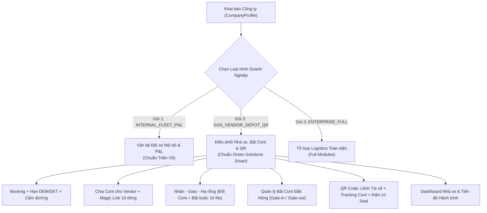
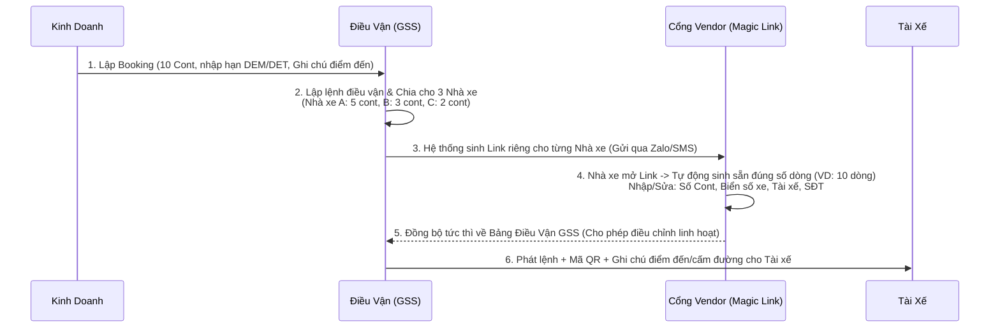
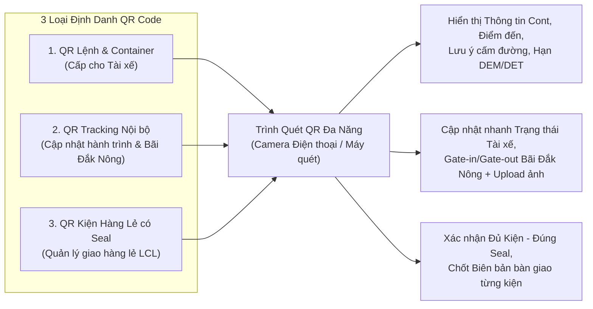
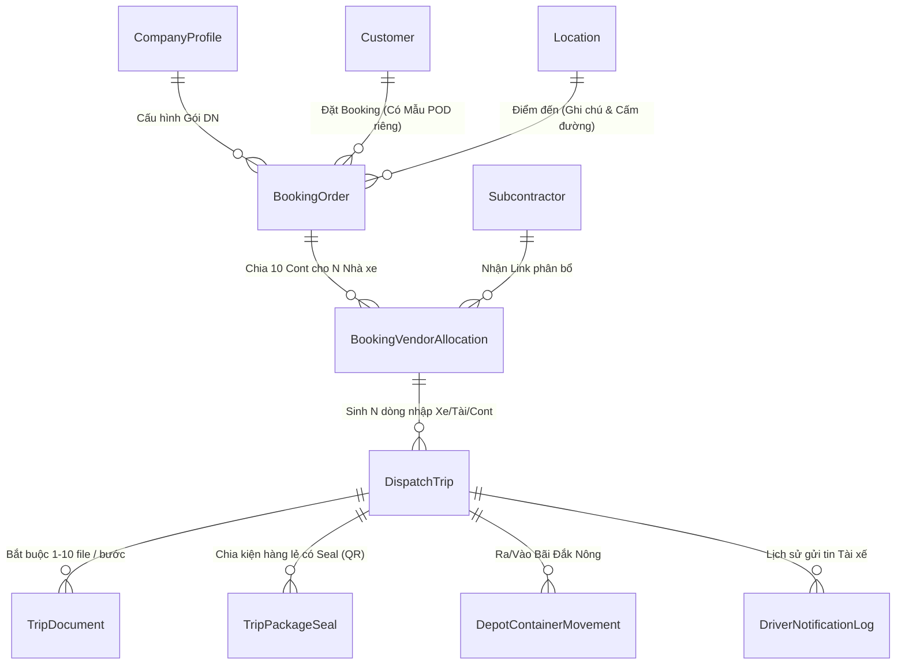

# TÀI LIỆU ĐẶC TẢ YÊU CẦU NGHIỆP VỤ & KẾ HOẠCH TRIỂN KHAI (BRD / PROJECT SCOPE)
## DỰ ÁN: HỆ THỐNG QUẢN TRỊ LOGISTICS & ĐIỀU VẬN THÔNG MINH – GREEN SOLUTIONS SMART (GSS)

> **Mã dự án:** GSS-TMS-2026  
> **Phiên bản tài liệu:** 1.1.0  
> **Ngày lập:** 04/11/2026  
> **Repo:** `GSS_LOGISTICs` (độc lập; tách ra từ nền tảng BIM Logistics, Django 5.2 Modular Monolith)  
> **Mô hình triển khai:** Single-Codebase, Multi-Instance (1 Mã nguồn chuẩn SaaS – Mỗi Khách hàng 1 Database độc lập, cấu hình theo Loại hình Doanh nghiệp)

---

## 0. HIỆN TRẠNG SO VỚI MÃ NGUỒN (cập nhật 05/11/2026)

| Hạng mục | Trạng thái trong code |
|:---|:---|
| Booking (`customers.BookingOrder`), Điều vận (`DispatchTrip`), Nhà xe (`Subcontractor`), Chứng từ (`documents.TripDocument`), Đội xe, Nhân sự, Đối soát | ✅ Đã có (kế thừa nền tảng) |
| Cảnh báo hạn DEM/DET (`dem_expiry`) | ⚠️ Mới có trên chuyến xe (`DispatchTrip`); **chưa** ở cấp Booking |
| `CompanyProfile` | ⚠️ Đã có hồ sơ công ty; **chưa** có `business_model` / `enabled_features` |
| `BookingVendorAllocation`, Vendor Portal (Magic Link) | ❌ [KẾ HOẠCH] Giai đoạn 2 |
| Ghi chú điểm đến, cấm đường, đổi số cont hạ rỗng, `DriverNotificationLog`, mẫu POD theo khách hàng | ❌ [KẾ HOẠCH] Giai đoạn 3 |
| `depot_yard` (Bãi Cont Đắk Nông), Dashboard Nhà xe | ❌ [KẾ HOẠCH] Giai đoạn 4 |
| `qr_tracking` (`TripPackageSeal`, quét QR) | ❌ [KẾ HOẠCH] Giai đoạn 5 |

---

## MỤC LỤC

1. [Tổng quan Dự án & Định hướng Kiến trúc SaaS](#1-tổng-quan-dự-án--định-hướng-kiến-trúc-saas)
2. [Đặc tả Chi tiết Yêu cầu Nghiệp vụ (Business Requirements)](#2-đặc-tả-chi-tiết-yêu-cầu-nghiệp-vụ-business-requirements)
   - [2.1. Cấu hình Loại hình Doanh nghiệp (Business Profile Selector)](#21-cấu-hình-loại-hình-doanh-nghiệp-business-profile-selector)
   - [2.2. Quản lý Booking, Hạn lệnh DEM/DET & Thông tin Điểm đến](#22-quản-lý-booking-hạn-lệnh-demdet--thông-tin-điểm-đến)
   - [2.3. Phân bổ Cont cho Nhà xe (Vendor Allocation) & Cổng Vendor Link](#23-phân-bổ-cont-cho-nhà-xe-vendor-allocation--cổng-vendor-link)
   - [2.4. Quy trình Điều vận, Trạng thái Tài xế & Kiểm soát Chứng từ Bắt buộc](#24-quy-trình-điều-vận-trạng-thái-tài-xế--kiểm-soát-chứng-từ-bắt-buộc)
   - [2.5. Quản lý Gửi tin Tài xế & Mẫu Biên bản Giao hàng theo Công ty](#25-quản-lý-gửi-tin-tài-xế--mẫu-biên-bản-giao-hàng-theo-công-ty)
   - [2.6. Quản lý Bãi Container – Depot Đắk Nông (Yard Management)](#26-quản-lý-bãi-container--depot-đắk-nông-yard-management)
   - [2.7. Hệ thống Mã QR Code: Cấp lệnh Tài xế, Tracking Cont & Hàng lẻ có Seal](#27-hệ-thống-mã-qr-code-cấp-lệnh-tài-xế-tracking-cont--hàng-lẻ-có-seal)
   - [2.8. Dashboard Điều hành Theo Nhà xe & Hành trình Container](#28-dashboard-điều-hành-theo-nhà-xe--hành-trình-container)
3. [Nền tảng Công nghệ: Django kết hợp Hệ sinh thái Hiện đại](#3-nền-tảng-công-nghệ-django-kết-hợp-hệ-sinh-thái-hiện-đại)
4. [Cấu trúc Thư mục Dự án (Project Structure)](#4-cấu-trúc-thư-mục-dự-án-project-structure)
5. [Thiết kế Cơ sở Dữ liệu Mở rộng (Database Schema & ERD)](#5-thiết-kế-cơ-sở-dữ-liệu-mở-rộng-database-schema--erd)
6. [Kế hoạch Triển khai Chi tiết (Implementation Roadmap)](#6-kế-hoạch-triển-khai-chi-tiết-implementation-roadmap)
7. [Tiêu chuẩn Nghiệm thu & Kiểm soát Chất lượng (QA/QC)](#7-tiêu-chuẩn-nghiệm-thu--kiểm-soát-chất-lượng-qaqc)

---

## 1. TỔNG QUAN DỰ ÁN & ĐỊNH HƯỚNG KIẾN TRÚC SAAS

### 1.1. Mục tiêu Dự án Green Solutions Smart (GSS)
Xây dựng hệ thống Quản trị Logistics & Điều vận Thông minh (**Green Solutions Smart – GSS**) đáp ứng trọn vẹn chuỗi nghiệp vụ từ lúc Kinh doanh nhận Booking (quản lý DEM/DET, ghi chú điểm đến, lưu ý cấm đường) $\rightarrow$ Điều vận chia chỉ tiêu container cho các Nhà xe thầu phụ (Vendor) qua liên kết thông minh $\rightarrow$ Giám sát hành trình thực tế (Nhận – Giao – Hạ rỗng đổi số cont, bắt buộc đính kèm tối đa 10 chứng từ mỗi bước) $\rightarrow$ Quản lý ra/vào Bãi Cont Đắk Nông $\rightarrow$ Định danh & truy vết toàn trình bằng mã QR Code cho cả Container nguyên (FCL) và Hàng lẻ theo kiện có Seal (LCL).

### 1.2. Chiến lược Sản phẩm Hóa (Single-Codebase, Configurable SaaS)
Hệ thống được phát triển trên cùng một nền tảng lõi nhưng phục vụ nhiều mô hình khách hàng khác nhau với nguyên tắc:
- **Mỗi khách hàng 1 Database độc lập (Isolated Database per Deployment):** Đảm bảo an toàn dữ liệu tuyệt đối, hiệu năng cao và dễ dàng tùy biến hạ tầng riêng cho từng doanh nghiệp.
- **Tự động nạp cấu phần theo Loại hình Doanh nghiệp (`CompanyProfile`):** Tại màn hình *Khai báo Thông tin Công ty*, Quản trị viên chỉ cần chọn **Loại hình doanh nghiệp**, hệ thống sẽ tự động bật/tắt các phân hệ trên Sidebar, Dashboard và các quy tắc kiểm soát (Workflow Rules) tương ứng.



---

## 2. ĐẶC TẢ CHI TIẾT YÊU CẦU NGHIỆP VỤ (BUSINESS REQUIREMENTS)

### 2.1. Cấu hình Loại hình Doanh nghiệp (Business Profile Selector)
- **Vị trí:** Phân hệ `Cài đặt` $\rightarrow$ `Khai Báo Ban Đầu` $\rightarrow$ `Thông Tin Công Ty`.
- **Chức năng:**
  - Chọn **Mô hình vận hành (`business_model`)**:
    1. `GSS_VENDOR_DEPOT_QR` *(Mặc định cho dự án GSS)*: Bật toàn bộ cấu phần Điều phối Vendor, Kiểm soát 10 chứng từ/bước, Đổi cont hạ rỗng, Bãi cont Đắk Nông, QR Code Cont/Hàng lẻ và Dashboard Nhà xe; ẩn các phân hệ không sử dụng (như Hải quan hoặc Lương BHXH nội bộ phức tạp) để giao diện tinh gọn.
    2. `INTERNAL_FLEET_PNL`: Bật cấu phần Đội xe nội bộ, Tạm ứng, Lương chuyến, Kế toán P&L.
    3. `ENTERPRISE_FULL`: Mở toàn bộ tính năng của nền tảng.
  - Bảng **Bật/Tắt Cấu phần Chi tiết (`enabled_features`)**: Cho phép bật/tắt linh hoạt từng tính năng nhỏ (Add-on) ngay trên giao diện mà không cần sửa code.

---

### 2.2. Quản lý Booking, Hạn lệnh DEM/DET & Thông tin Điểm đến
1. **Quản lý Hạn lệnh DEM / DET ngay từ khâu Kinh doanh:**
   - Khi nhân viên Kinh doanh (KD) lập Booking mới, hệ thống cung cấp cụm trường nhập:
     - **Số ngày miễn phí DEM / DET** (`dem_free_days`, `det_free_days`).
     - **Hạn lệnh DEM (`dem_expiry_date`)** – Ngày hết hạn lưu bãi tại cảng/depot.
     - **Hạn lệnh DET (`det_expiry_date`)** – Ngày hết hạn lưu vỏ container miễn phí.
   - Dữ liệu hạn lệnh này được **kế thừa tự động** xuống tất cả các lệnh điều vận/container thuộc Booking đó và hiển thị cảnh báo màu (Xanh: An toàn, Vàng: Sắp đến hạn $\le 2$ ngày, Đỏ: Quá hạn).
2. **Ghi chú Điểm đến & Lưu ý Cấm đường:**
   - Tại Danh mục Địa điểm (`Location`) và trên từng Booking/Lệnh điều vận, bổ sung 2 trường thông tin chuyên biệt:
     - **Ghi chú điểm đến (`destination_notes`)**: Hướng dẫn chi tiết cho tài xế khi tiếp cận kho/nhà máy (người liên hệ nhận hàng, cổng vào, quy định bảo hộ lao động, thủ tục đăng ký bảo vệ...).
     - **Lưu ý cấm đường / Giờ cấm tải (`road_restrictions`)**: Cảnh báo các tuyến đường cấm container, khung giờ cấm tải nội đô, cầu yếu hoặc đoạn đường đang sửa chữa.
   - Các thông tin này được hiển thị nổi bật trên **Màn hình Tài xế (Driver Portal)** và đính kèm trong tin nhắn gửi cho tài xế.

---

### 2.3. Phân bổ Cont cho Nhà xe (Vendor Allocation) & Cổng Vendor Link
Giải quyết bài toán: **1 Booking có nhiều container (VD: 10 cont) cần chia cho nhiều Nhà xe thầu phụ (VD: 3 nhà xe)**.



- **Quy trình chi tiết:**
  1. **Bước 1 – KD xử lý Booking:** KD tạo Booking với tổng số lượng cont (VD: `total_containers = 10`).
  2. **Bước 2 – Điều vận chia Cont cho Vendor:**
     - Điều vận chọn Booking và phân bổ số lượng cont cho từng Nhà xe (`Subcontractor`):
       - *Ví dụ:* Chia cả 10 cont cho 1 Vendor, hoặc chia 10 cont cho 3 Vendor (Nhà xe A: 4 cont, Nhà xe B: 3 cont, Nhà xe C: 3 cont).
     - Hệ thống tự động tạo mã liên kết bảo mật (**Vendor Magic Link** dạng `/vendor-portal/<token>/`) cho từng phiếu phân bổ.
  3. **Bước 3 – Vendor nhận Link & Nhập danh sách Xe/Tài/Cont:**
     - Khi Vendor bấm vào link (trên máy tính hoặc điện thoại), hệ thống **tự động sinh ra đúng số dòng** tương ứng với số lượng cont được giao (VD: giao 10 cont sẽ hiện sẵn bảng 10 dòng từ Dòng #1 đến Dòng #10).
     - Trên mỗi dòng, Vendor nhập:
       - **Số Container** (nếu đã có) & **Số Seal**
       - **Biển số xe đầu kéo / Xe tải**
       - **Biển số Rơ-moóc**
       - **Họ tên Tài xế** & **Số điện thoại Tài xế**
       - **Ghi chú của Nhà xe**
  4. **Bước 4 – Quyền điều chỉnh linh hoạt:**
     - Cả Vendor (khi chưa khóa chặng) và Điều vận GSS đều có thể **điều chỉnh/cập nhật lại Số cont, Biển số xe, Tài xế** bất cứ lúc nào khi có sự thay đổi phương tiện ngoài hiện trường. Mọi thay đổi được ghi nhận vào nhật ký `AuditLog`.

---

### 2.4. Quy trình Điều vận, Trạng thái Tài xế & Kiểm soát Chứng từ Bắt buộc

#### A. Luồng 3 Giai đoạn Chính của Điều vận & Bắt buộc Chứng từ (Tối đa 10 file/bước)
Sau khi có thông tin Xe/Tài từ Vendor, Điều vận (hoặc Tài xế qua Portal/QR) thực hiện cập nhật các bước tiếp theo theo chuỗi kiểm soát nghiêm ngặt:

| Giai đoạn Điều vận | Trạng thái chi tiết của Tài xế | Quy tắc Chứng từ & Nghiệp vụ Bắt buộc |
| :--- | :--- | :--- |
| **Bước 1: NHẬN CONT / NHẬN HÀNG**<br>(`PICKUP_STAGE`) | • `ARRIVED_AT_PICKUP`: Đã đến nơi nhận<br>• `LOADED_ON_VEHICLE`: Đã lên xe (Đã lấy cont/hàng) | - **Bắt buộc đính kèm chứng từ** (Phiếu EIR cấp rỗng / Phiếu xuất kho / Ảnh cont & seal): Tối thiểu **1 file**, tối đa **10 file** (Ảnh/PDF).<br>- Chưa có file $\rightarrow$ Hệ thống chặn không cho chuyển sang bước Giao. |
| **Bước 2: GIAO HÀNG**<br>(`DELIVERY_STAGE`) | • `ARRIVED_AT_DELIVERY`: Đã đến nơi giao<br>• `UNLOADED_FROM_VEHICLE`: Đã hạ xe / Đã giao hàng xong | - **Bắt buộc đính kèm chứng từ** (Biên bản giao hàng POD có ký nhận, ảnh dỡ hàng/cắt seal): Tối thiểu **1 file**, tối đa **10 file**.<br>- Hỗ trợ in/xuất **Mẫu biên bản giao hàng theo đúng mẫu của từng công ty khách hàng**. |
| **Bước 3: HẠ RỖNG**<br>(`EMPTY_RETURN_STAGE`) | • `RETURNING_EMPTY`: Đang đi hạ rỗng<br>• `EMPTY_RETURNED`: Đã hạ rỗng (Hoàn tất) | - **Bắt buộc đính kèm chứng từ** (Phiếu EIR hạ rỗng, ảnh vỏ cont tại bãi hạ): Tối thiểu **1 file**, tối đa **10 file**.<br>- **Cho phép cập nhật Số Cont mới khi hạ rỗng** (Xem mục B bên dưới). |

#### B. Nghiệp vụ Cập nhật Số Cont mới khi Hạ rỗng (Empty Return Container Swap)
- **Bài toán thực tế:** Nhà xe (Vendor) sau khi giao hàng xong cho khách có thể giữ lại vỏ cont cũ để đóng hàng khác và **lấy một vỏ container khác (cùng hãng tàu/quy cách) đi hạ rỗng** để trả lệnh.
- **Giải pháp trên hệ thống:**
  - Tại bước **Hạ rỗng**, hệ thống hiển thị mặc định số cont ban đầu (`container_number`), kèm tùy chọn **`[Đổi số Cont hạ rỗng]`**.
  - Khi tích chọn, Điều vận/Tài xế nhập **Số Cont hạ rỗng thực tế (`return_container_number`)** và **Lý do đổi vỏ cont** (`swap_reason`).
  - Hệ thống bảo toàn **cả 2 số cont** trên cùng một chuyến:
    - `container_number`: Số cont lúc nhận/giao hàng.
    - `return_container_number`: Số cont thực tế đã hạ rỗng trả bãi.
    - Hiển thị rõ nhãn `🔄 Đổi vỏ hạ: [Cont Cũ] ➔ [Cont Mới]` trên Bảng Điều vận để dễ dàng tra cứu và đối soát DEM/DET.

#### C. Chức năng Load Hình / File Đa phương tiện
- Hỗ trợ kéo-thả (Drag & Drop), chọn nhiều file cùng lúc từ máy tính/điện thoại, chụp ảnh trực tiếp bằng camera điện thoại hoặc **dán ảnh trực tiếp từ Clipboard (`Ctrl + V`)**.
- Giới hạn tối đa **10 file / 1 bước nghiệp vụ**, tự động nén ảnh thông minh phía trình duyệt để tải lên mượt mà ngay cả khi sóng 3G/4G yếu tại cảng/bãi.

---

### 2.5. Quản lý Gửi tin Tài xế & Mẫu Biên bản Giao hàng theo Công ty

1. **Quản lý Gửi tin cho Tài xế (`DriverNotificationLog`):**
   - Ngay trên dòng lệnh điều vận, Điều vận có nút **`[Gửi tin Tài xế]`**.
   - Nội dung bản tin được tổng hợp tự động theo mẫu chuẩn:
     - Thông tin chuyến: Số Cont, Loại Cont, Lộ trình Nhận – Giao – Hạ, Hạn lệnh DEM/DET.
     - **Ghi chú điểm đến** & **Lưu ý cấm đường**.
     - Đường dẫn **Driver Portal & Mã QR Code** của chuyến.
   - Hỗ trợ: Sao chép nhanh (1-click Copy) để gửi nhóm Zalo, mở trực tiếp Zalo chat theo SĐT tài xế, hoặc tích hợp API Zalo ZNS / SMS Brandname; lưu lại lịch sử đã gửi tin lúc mấy giờ, ai gửi, tài xế đã mở xem chưa.

2. **Mẫu Biên bản Giao hàng (POD Template) theo từng Công ty Khách hàng:**
   - Mỗi Khách hàng (`Customer`) có thể sử dụng biểu mẫu biên bản giao nhận hàng hóa với bố cục, logo, điều khoản và các cột thông tin riêng.
   - Hệ thống cho phép gắn `pod_template_code` (hoặc cấu hình mẫu HTML/Print động) cho từng Khách hàng. Khi nhấn **`[In Biên Bản Giao Hàng]`** từ lệnh điều vận, hệ thống tự động nhận diện Khách hàng của Booking đó và xuất ra đúng mẫu biên bản của công ty đó, điền sẵn Số Cont, Số Seal, Biển số xe, Tài xế, Số kiện.

---

### 2.6. Quản lý Bãi Container – Depot Đắk Nông (Yard Management)

Xây dựng phân hệ chuyên biệt **Quản lý Bãi Cont Đắk Nông** để kiểm soát chặt chẽ lượng vỏ/hàng ra vào bãi:

1. **Quản lý Lượt Cont Đến (Gate-In) & Cont Đi (Gate-Out):**
   - **Thông tin Gate-In (Cont vào bãi):**
     - Số Container, Quy cách (20DC, 40HC...), Hãng tàu, Tình trạng (Cont Hàng / Cont Rỗng), Tình trạng kỹ thuật vỏ.
     - **Ngày đến – Giờ đến** (`gate_in_at` – chính xác đến phút).
     - **Biển số xe chở đến** (`in_vehicle_plate`), Rơ-moóc, Tên & SĐT Tài xế, Nhà xe (Vendor).
     - Liên kết với Lệnh điều vận/Booking (nếu có) và đính kèm hình ảnh kiểm định tại cổng (tối đa 10 ảnh).
   - **Thông tin Gate-Out (Cont rời bãi):**
     - **Ngày đi – Giờ đi** (`gate_out_at`).
     - **Biển số xe kéo đi** (`out_vehicle_plate`), Tên & SĐT Tài xế nhận cont.
     - Mục đích xuất bãi (Giao khách / Kéo về cảng hạ rỗng / Chuyển bãi).
2. **Thống kê & Chỉ số Bãi Đắk Nông theo Thời gian thực:**
   - **Tổng số lượng cont đang tồn bãi** (Tách biệt: Cont Hàng vs. Cont Rỗng; Phân nhóm theo Nhà xe / Chủ hàng).
   - **Tổng lượt Cont Đến hôm nay** & **Tổng lượt Cont Đi hôm nay**.
   - Tính toán tự động **Số ngày lưu bãi (Storage Days)** của từng container tại bãi Đắk Nông.

---

### 2.7. Hệ thống Mã QR Code: Cấp lệnh Tài xế, Tracking Cont & Hàng lẻ có Seal

Hệ thống QR Code được thiết kế đồng bộ trên toàn nền tảng, phục vụ 3 mục đích cốt lõi:



1. **Tạo Mã QR cấp cho Tài xế (Container / Trip QR):**
   - Mỗi dòng container sau khi gán xe/tài sẽ tự động sinh một **Thẻ Lệnh QR Code (E-Pass)** chứa các thông tin chính: Mã chuyến, Số Container, Số Seal, Biển số xe, Tài xế, Điểm nhận, Điểm giao, Ghi chú điểm đến & Lưu ý cấm đường.
   - Tài xế lưu ảnh QR trên điện thoại hoặc mở qua link được gửi để xuất trình tại kho nhận/giao hoặc cổng bãi Đắk Nông.
2. **Tracking Cont Nội bộ qua QR Code:**
   - Khi Nhân viên hiện trường, Bảo vệ kho, Thủ bãi Đắk Nông hoặc Tài xế quét mã QR bằng điện thoại:
     - **Chế độ Tra cứu:** Hiển thị ngay lịch sử hành trình của container, chứng từ đã tải lên, nhà xe phụ trách và thông tin liên hệ.
     - **Chế độ Tác nghiệp (theo quyền):** Cho phép bấm nút cập nhật nhanh trạng thái (*Đã đến nơi nhận, Đã lên xe, Gate-in Bãi Đắk Nông, Đã đến nơi giao, Đã hạ xe, Đã hạ rỗng*) và chụp ảnh chứng từ tại chỗ.
3. **Giao hàng lẻ: Quản lý Số kiện có Seal bằng QR Code (LCL Sealed Packages):**
   - Đối với đơn hàng giao lẻ (hoặc 1 chuyến/cont chia làm nhiều kiện/pallet niêm phong):
     - Cho phép khai báo **Danh sách Kiện hàng (`TripPackageSeal`)**: Mã kiện, Thứ tự kiện (VD: Kiện 1/20, 2/20...), **Mã Seal riêng của kiện**, Trọng lượng/Số khối, Người nhận từng điểm.
     - Hệ thống tạo và in **Tem QR Code cho từng Kiện/Seal** (hỗ trợ in hàng loạt trên giấy tem nhiệt hoặc A4).
     - Khi bốc hàng lên xe và khi giao hàng tại điểm đến, tài xế/nhân viên kho **quét mã QR từng kiện** để đối chiếu tự động: Đã giao đủ số kiện chưa? Mã Seal trên kiện có khớp 100% không? Kiện nào bị rách seal hoặc giao thiếu sẽ cảnh báo tức thì.

---

### 2.8. Dashboard Điều hành Theo Nhà xe & Hành trình Container

Màn hình Dashboard trung tâm của GSS được thiết kế chuyên biệt để Ban Giám đốc và Trưởng phòng Điều vận nắm bắt tức thì năng lực thực thi của các Nhà xe (Vendor):

1. **4 Thẻ KPI Tổng quan Đầu trang:**
   - **Tổng Cont Đang Điều Phối:** Tổng số cont theo Booking đang chạy / Số nhà xe tham gia.
   - **Tiến Độ Hành Trình (Nhận – Giao – Hạ):** Số cont *Đã nhận* | *Đã giao* | *Đã hạ rỗng hoàn tất*.
   - **Tồn Bãi Cont Đắk Nông:** Tổng số cont đang nằm tại bãi (Cont đến hôm nay / Cont đi hôm nay).
   - **Cảnh Báo Hạn Lệnh DEM/DET:** Số cont sắp hết hạn ($\le 2$ ngày) hoặc đã quá hạn chưa hạ rỗng.
2. **Bảng Ma trận Theo dõi Nhà xe (Vendor Container Matrix):**
   Hiển thị chi tiết từng Nhà xe (Vendor) theo thời gian thực:

   | Nhà Xe (Vendor) | Tổng Cont Giao | Chờ Nhập Xe/Tài | Đã Nhận Cont | Đang Đi Giao | Đã Giao Hàng | Đã Hạ Rỗng | Đổi Vỏ Hạ | Cảnh Báo DEM/DET |
   | :--- | :---: | :---: | :---: | :---: | :---: | :---: | :---: | :---: |
   | **Nhà xe A** | 10 | 0 | 10 | 3 | 7 | 5 | 1 | 0 |
   | **Nhà xe B** | 8 | 2 | 6 | 4 | 2 | 2 | 0 | 1 ⚠️ |
   | **Nhà xe C** | 5 | 0 | 5 | 0 | 5 | 5 | 0 | 0 |

   *(Bấm vào bất kỳ con số nào trên bảng sẽ lọc và mở ngay danh sách các container tương ứng).*

---

## 3. NỀN TẢNG CÔNG NGHỆ: DJANGO KẾT HỢP HỆ SINH THÁI HIỆN ĐẠI

Dự án sử dụng kiến trúc **Modular Monolith trên nền tảng Django 5.2**, kết hợp với Frontend SPA hiện đại và các thư viện chuyên dụng cho Logistics & QR Code:

| Tầng Kiến Trúc | Công Nghệ / Thư Viện | Vai Trò Trong Hệ Thống GSS |
| :--- | :--- | :--- |
| **Core Backend** | **Python 3.12 & Django 5.2 LTS** | Xử lý logic nghiệp vụ, ORM, phân quyền RBAC, State Machine, Audit Log và quản lý cấu hình gói SaaS (`CompanyProfile`). |
| **RESTful API** | **Django REST Framework (DRF)** | Cung cấp API tốc độ cao cho Web SPA, Cổng Vendor Magic Link, Cổng Tài xế và Trình quét QR trên di động. |
| **Authentication** | **SimpleJWT + Session + Magic Token** | Đăng nhập nội bộ bằng JWT/Session; truy cập không mật khẩu (Passwordless) an toàn cho Vendor và Tài xế qua chuỗi băm `token` có kiểm soát thời hạn. |
| **Database** | **PostgreSQL 16** *(Prod)* / **SQLite3** *(Dev)* | Lưu trữ dữ liệu quan hệ bền vững, hỗ trợ `JSONField` cho cấu hình động `enabled_features` và metadata sự kiện QR. |
| **Frontend SPA** | **Modular Vanilla JS (ES6+) + Tailwind CSS** | Chia nhỏ mã nguồn theo từng phân hệ trong `static/js/src/app/`, đóng gói tự động thành `app.js` giúp phản hồi tức thì không cần tải lại trang. |
| **QR Code Engine** | **`qrcode` (Python) + `html5-qrcode` & `qrcodejs` (JS)** | Sinh mã QR sắc nét (SVG/PNG) để in tem Cont/Kiện hàng lẻ; quét mã QR trực tiếp bằng Camera điện thoại ngay trên trình duyệt Web (không cần cài App). |
| **Xử lý File & Ảnh** | **Pillow + Client-side Image Compression** | Xử lý upload đa file (tối đa 10 file/bước), kiểm tra định dạng an toàn (Magic Bytes), tự động nén ảnh chụp từ điện thoại tài xế. |
| **Biểu mẫu & Xuất file** | **Print CSS Engine (A4/Thermal) + SheetJS / OpenPyXL** | Kết xuất Biên bản giao hàng (POD) theo mẫu từng công ty, in phiếu Bãi Đắk Nông, in tem QR và nhập/xuất dữ liệu Excel. |
| **Thông báo** | **Zalo ZNS / SMS Webhook / Web Notification** | Quản lý gửi tin điều lệnh, lưu ý cấm đường và ghi chú điểm đến cho tài xế. |
| **Hạ tầng Triển khai** | **Docker + Docker Compose + Gunicorn + Nginx** | Đóng gói chuẩn hóa; triển khai khách hàng mới chỉ bằng 1 lệnh khởi chạy container với biến môi trường `.env` riêng. |

---

## 4. CẤU TRÚC THƯ MỤC DỰ ÁN (PROJECT STRUCTURE)

Dưới đây là cấu trúc thư mục đầy đủ của dự án (repo `GSS_LOGISTICs`; hạng mục đánh dấu `[MỚI]` là phần sẽ bổ sung):

```text
GSS_LOGISTICs/
├── config/                            # Cấu hình trung tâm của Django Project
│   ├── settings.py                    # Cấu hình Database, Media, JWT, SaaS Flags
│   ├── urls.py                        # Định tuyến URL gốc & API Endpoints
│   └── wsgi.py                        # Entry-point cho Gunicorn Production
│
├── core/                              # Lõi nền tảng dùng chung (Core Engine)
│   ├── models.py                      # TimeStampedModel, SoftDeleteModel, Company, TrackingEventLog, AuditLog
│   ├── workflows.py                   # State Machine: Luồng Nhận - Giao - Hạ rỗng & Kiểm tra 10 chứng từ
│   ├── tenant.py                      # Quản lý ngữ cảnh Công ty & Feature Flags
│   └── sequences.py                   # Bộ sinh mã tự động (BK, DV, YARD, QR...)
│
├── apps/                              # Các Phân hệ Nghiệp vụ (Modular Apps)
│   ├── master_data/                   # Danh mục dùng chung & Cấu hình Công ty
│   │   └── models.py                  # CompanyProfile (chọn Loại hình DN), Location (Ghi chú điểm đến, Cấm đường), Subcontractor
│   ├── customers/                     # Phân hệ Kinh doanh, Khách hàng & Booking
│   │   └── models.py                  # Customer (Mẫu POD riêng), BookingOrder (Quản lý hạn lệnh DEM/DET)
│   ├── dispatch/                      # Phân hệ Điều vận, Vendor Portal & Gửi tin Tài xế
│   │   ├── models.py                  # DispatchTrip (Đổi số cont hạ rỗng, Trạng thái tài xế), BookingVendorAllocation, DriverNotificationLog
│   │   ├── views.py                   # API Điều vận, API Chia Cont Vendor, API Vendor Magic Link (nhập 10 dòng)
│   │   └── timeline_service.py        # Đồng bộ các mốc thời gian hành trình
│   ├── documents/                     # Phân hệ Chứng từ Bắt buộc theo Bước (Tối đa 10 file/bước)
│   │   └── models.py                  # TripDocument (Phân loại theo bước: PICKUP, DELIVERY, EMPTY_RETURN)
│   ├── depot_yard/                    # [MỚI] Phân hệ Quản lý Bãi Cont (Depot Đắk Nông)
│   │   ├── models.py                  # DepotContainerMovement (Gate-in, Gate-out, Ngày/Giờ/Biển số xe, Tồn bãi)
│   │   └── views.py                   # API Xuất/Nhập bãi Đắk Nông & Thống kê tồn bãi
│   ├── qr_tracking/                   # [MỚI] Phân hệ Định danh QR Code & Hàng lẻ có Seal
│   │   ├── models.py                  # TripPackageSeal (Kiện hàng lẻ, Số Seal, Mã QR), QRScanHistory
│   │   └── views.py                   # API Sinh mã QR, Quét mã QR cập nhật trạng thái Cont & Kiện hàng lẻ
│   ├── fleet/                         # Quản lý Đội xe & Rơ-moóc (Nội bộ & Nhà xe 3PL)
│   ├── collaboration/                 # Tin tức, Công việc, Chat nhóm (đã có)
│   ├── customs/                       # Hải quan (đã có; ẩn theo gói GSS_VENDOR_DEPOT_QR)
│   ├── ledger/                        # Sổ cái, bút toán (đã có)
│   ├── personnel/                     # Quản lý Nhân sự & Tài xế
│   ├── billing/                       # Quản lý Chi phí & Đối soát Nhà xe
│   └── exceptions/                    # Quản lý Sự cố hiện trường (OS&D)
│
├── static/                            # Tài nguyên Tĩnh & Mã nguồn Frontend SPA
│   ├── css/
│   │   └── main.css                   # Hệ thống Design System & Print Styles
│   └── js/
│       ├── app.js                     # File bundle tự sinh (từ scripts/build_app_js.py)
│       └── src/app/                   # Mã nguồn JS phân tách theo từng Module
│           ├── core/                  # Hàm dùng chung, Feature Flag Helper (hasFeature)
│           ├── dashboard/             # Dashboard P&L & Dashboard Nhà xe (Vendor Matrix)
│           ├── sales/                 # Giao diện Booking (DEM/DET, Ghi chú điểm đến, Cấm đường)
│           ├── dispatch/              # Điều vận, Chia Cont cho Vendor, Bắt buộc 10 file, Đổi cont hạ rỗng
│           ├── vendor-portal/         # [MỚI] Giao diện lưới (Grid) cho Vendor nhập Xe/Tài/Cont qua Link
│           ├── depot-yard/            # [MỚI] Giao diện Quản lý Bãi Cont Đắk Nông
│           ├── qr-tracking/           # [MỚI] Giao diện Tạo/In QR, Camera Quét QR & Giao hàng lẻ có Seal
│           └── master-data/           # Khai báo Loại hình Công ty & Mẫu Biên bản giao hàng (POD)
│
├── templates/                         # Giao diện HTML (Django Templates + SPA Views)
│   ├── base.html                      # Khung giao diện chính
│   ├── index.html                     # Điểm nạp các View SPA
│   ├── vendor_portal.html             # [MỚI] Trang độc lập cho Nhà xe nhập danh sách Cont/Xe/Tài
│   ├── qr_scanner_portal.html         # [MỚI] Trang quét QR nhanh trên điện thoại cho Tài xế/Thủ bãi
│   └── views/
│       ├── view_dashboard.html        # Tích hợp chế độ Dashboard Nhà xe (Vendor & Cont)
│       ├── view_booking_detail.html   # Tích hợp hạn lệnh DEM/DET & Chia Vendor
│       ├── view_dispatch.html         # Bảng điều vận & Kiểm soát chứng từ Nhận - Giao - Hạ
│       ├── view_depot_daknong.html    # [MỚI] Màn hình Quản lý Bãi Cont Đắk Nông
│       └── view_qr_management.html    # [MỚI] Màn hình Quản lý QR & Hàng lẻ có Seal
│
├── docs/                              # Tài liệu Đặc tả Kỹ thuật & Nghiệp vụ (Documentation-as-Code)
│   └── BRD_GREEN_SOLUTIONS_SMART_GSS.md
├── scripts/
│   └── build_app_js.py                # Công cụ ghép nối các module JS
├── Dockerfile
├── docker-compose.yml
└── requirements.txt
```

---

## 5. THIẾT KẾ CƠ SỞ DỮ LIỆU MỞ RỘNG (DATABASE SCHEMA & ERD)

### 5.1. Sơ đồ Quan hệ Thực thể (ERD) Trọng tâm của GSS



### 5.2. Chi tiết Các Bảng Mới & Các Trường Mở rộng

| Tên Bảng (Model) | Phân loại | Các Trường Dữ Liệu Cốt Lõi (Fields) |
| :--- | :---: | :--- |
| **`master_data.CompanyProfile`** | *Mở rộng* | `business_model` (`INTERNAL_FLEET_PNL`, `GSS_VENDOR_DEPOT_QR`, `ENTERPRISE_FULL`), `enabled_features` (`JSONField` lưu cấu hình bật/tắt module). |
| **`master_data.Location`** | *Mở rộng* | `destination_notes` (Ghi chú tiếp cận điểm đến cho tài xế), `road_restrictions` (Lưu ý giờ cấm tải, tuyến đường cấm). |
| **`customers.Customer`** | *Mở rộng* | `pod_template_type` (Mã mẫu biên bản giao hàng riêng), `pod_custom_header`, `pod_custom_terms` (Điều khoản biên bản giao nhận của từng công ty). |
| **`customers.BookingOrder`** | *Mở rộng* | `dem_free_days`, `det_free_days`, `dem_expiry_date` (Hạn DEM), `det_expiry_date` (Hạn DET), `destination_notes`, `road_restrictions`. |
| **`dispatch.BookingVendorAllocation`** | **Mới** | `booking` (FK), `subcontractor` (FK Nhà xe), `allocated_containers` (Số cont giao, VD: 10), `vendor_token` (Mã link duy nhất), `status` (`PENDING`, `PARTIAL`, `SUBMITTED`, `LOCKED`), `expires_at`. |
| **`dispatch.DispatchTrip`** | *Mở rộng* | `vendor_allocation` (FK), `driver_step_status` (*Đã đến nơi nhận, Đã lên xe, Đã đến nơi giao, Đã hạ xe, Đã hạ rỗng*), `return_container_number` (Số cont mới khi hạ rỗng), `is_container_swapped` (Boolean), `container_swap_reason`, `qr_code_token`. |
| **`documents.TripDocument`** | *Mở rộng* | `workflow_stage` (`PICKUP` - Nhận, `DELIVERY` - Giao, `EMPTY_RETURN` - Hạ rỗng), `sequence_no` (Thứ tự file 1..10 trong bước). |
| **`dispatch.DriverNotificationLog`** | **Mới** | `trip` (FK), `driver_name`, `driver_phone`, `channel` (`ZALO`, `SMS`, `PORTAL_LINK`), `message_content` (Kèm điểm đến & cấm đường), `sent_by`, `sent_at`, `is_read`. |
| **`depot_yard.DepotContainerMovement`** | **Mới** | `yard_location` (Mặc định: *Bãi Cont Đắk Nông*), `container_number`, `container_type`, `cargo_status` (`FULL`/`EMPTY`), `trip` (FK nullable), `subcontractor` (FK), `gate_in_at` (Ngày giờ đến), `in_vehicle_plate` (Xe đến), `in_driver_name`, `gate_out_at` (Ngày giờ đi), `out_vehicle_plate` (Xe đi), `out_driver_name`, `status` (`IN_YARD`, `DEPARTED`). |
| **`qr_tracking.TripPackageSeal`** | **Mới** | `trip` (FK), `package_code` (Mã kiện), `package_index` (Kiện thứ $i/N$), `seal_number` (Số Seal kiện), `qr_token` (Mã QR định danh kiện), `weight_kg`, `cbm`, `recipient_name`, `status` (`CREATED`, `LOADED`, `IN_TRANSIT`, `DELIVERED`, `DAMAGED`), `scanned_at_pickup`, `scanned_at_delivery`. |

---

## 6. KẾ HOẠCH TRIỂN KHAI CHI TIẾT (IMPLEMENTATION ROADMAP)

Dự án được chia thành **5 Giai đoạn (Sprints)** tuần tự, đảm bảo hoàn thành đến đâu kiểm thử và chạy thực tế được ngay đến đó:

### Giai đoạn 1: Khởi tạo Dự án Mới & Bộ Khung Cấu hình Loại hình Doanh nghiệp (SaaS Core)
- **Công việc:**
  1. ✅ *Đã làm:* nhân bản codebase sang repo `GSS_LOGISTICs`, tách tên/cổng/CSDL/máy chủ khỏi BIM Logistics (xem mục 0 của `DEVELOPMENT_PLAN.md`).
  2. Nâng cấp `CompanyProfile` với bộ chọn **Loại hình Doanh nghiệp (`GSS_VENDOR_DEPOT_QR`)** và bảng bật/tắt cấu phần `enabled_features`.
  3. Xây dựng cơ chế tự động ẩn/hiện Sidebar, Dashboard và các trường trên Form theo loại hình công ty đã chọn.
- **Kết quả bàn giao:** Chuyển đổi qua lại giữa mô hình *Triền Võ* và mô hình *Green Solutions Smart (GSS)* chỉ bằng 1 cú nhấp chuột trong phần Cài đặt Công ty.

### Giai đoạn 2: Nghiệp vụ Booking (DEM/DET, Điểm đến, Cấm đường) & Chia Cont qua Vendor Link
- **Công việc:**
  1. Bổ sung trường nhập hạn lệnh **DEM/DET** cho Kinh doanh ngay khi tạo Booking; bổ sung **Ghi chú điểm đến** và **Lưu ý cấm đường** tại Danh mục Địa điểm & Booking.
  2. Xây dựng chức năng **Chia Cont cho Nhà xe (`BookingVendorAllocation`)**: Cho phép chia $N$ cont của Booking cho 1 hoặc nhiều Vendor.
  3. Xây dựng trang **Vendor Portal Link**: Khi Vendor mở link, tự động hiển thị bảng lưới $N$ dòng để nhập/chỉnh sửa Số cont, Số xe, Tài xế, SĐT và đồng bộ thẳng về bảng Điều vận.
- **Kết quả bàn giao:** Luồng khép kín từ *KD lập Booking $\rightarrow$ Điều vận chia 10 cont cho 3 nhà xe $\rightarrow$ Nhà xe mở link nhập 10 dòng xe/tài*.

### Giai đoạn 3: Luồng Điều vận (Nhận – Giao – Hạ rỗng), Bắt buộc 10 Chứng từ, Đổi Cont & Gửi tin Tài xế
- **Công việc:**
  1. Cập nhật các trạng thái chi tiết của Tài xế (*Đã đến nơi nhận, Đã lên xe, Đã đến nơi giao, Đã hạ xe, Đã hạ rỗng*).
  2. Thiết lập quy tắc **Bắt buộc đính kèm chứng từ (1–10 file/bước)** cho từng chặng Nhận – Giao – Hạ rỗng; tích hợp trình upload đa file/ảnh nhanh.
  3. Xây dựng tính năng **Cập nhật số Cont mới khi Hạ rỗng** (`return_container_number`) kèm lưu vết số cont cũ.
  4. Xây dựng tính năng **Gửi tin cho Tài xế** (kèm điểm đến, lưu ý cấm đường) và cấu hình **Mẫu biên bản giao hàng (POD) theo từng công ty khách hàng**.
- **Kết quả bàn giao:** Kiểm soát chặt chẽ từng bước của điều vận và tài xế, không thể bỏ sót chứng từ, xử lý trọn vẹn nghiệp vụ đổi vỏ cont khi hạ rỗng.

### Giai đoạn 4: Quản lý Bãi Cont Đắk Nông & Dashboard Nhà xe
- **Công việc:**
  1. Xây dựng màn hình **Bãi Cont Đắk Nông**: Quản lý Gate-In (Cont đến: ngày, giờ, biển số xe đến) và Gate-Out (Cont đi: ngày, giờ, biển số xe đi), danh sách tồn bãi thời gian thực và đính kèm hình ảnh tại bãi.
  2. Xây dựng **Dashboard GSS**: Biểu đồ & Bảng tổng hợp theo từng Nhà xe (Số lượng cont đang giữ, Đã nhận, Đã giao, Đã hạ rỗng, Cảnh báo hạn DEM/DET).
- **Kết quả bàn giao:** Quản lý minh bạch 100% biến động cont tại Bãi Đắk Nông và bảng điều khiển tiến độ toàn bộ Nhà xe cho Ban Giám đốc.

### Giai đoạn 5: Hệ thống Mã QR Code (Lệnh Tài xế, Tracking Cont & Giao Hàng lẻ có Seal)
- **Công việc:**
  1. Tích hợp bộ tạo **Mã QR cho từng Lệnh/Container** cấp cho tài xế.
  2. Xây dựng phân hệ **Giao hàng lẻ theo Kiện có Seal (`TripPackageSeal`)**: Tạo danh sách kiện + số seal, in tem QR cho từng kiện.
  3. Xây dựng **Màn hình Quét QR bằng Camera điện thoại (`html5-qrcode`)**: Quét mã QR để xem thông tin cont, cập nhật trạng thái hành trình nội bộ, xác nhận ra/vào Bãi Đắk Nông và kiểm đếm đủ kiện/đúng seal khi giao hàng lẻ.
- **Kết quả bàn giao:** Hoàn thiện hệ sinh thái Tracking bằng QR Code cho cả hàng Cont (FCL) và hàng lẻ (LCL).

---

## 7. TIÊU CHUẨN NGHIỆM THU & KIỂM SOÁT CHẤT LƯỢNG (QA/QC)

1. **Toàn vẹn Pháp lý & Chứng từ (No Hard-Delete):** Toàn bộ dữ liệu Booking, Lệnh điều vận, Lịch sử đổi số cont hạ rỗng, Chứng từ 10 file/bước, Lịch sử ra/vào Bãi Đắk Nông và Nhật ký quét QR đều sử dụng cơ chế xóa mềm (`is_deleted = True`), lưu vết tuyệt đối trong `AuditLog` và `TrackingEventLog`.
2. **Trải nghiệm Di động (Mobile-First cho Vendor, Tài xế & Thủ bãi):** Giao diện Vendor Link, Driver Portal và Màn hình Quét QR được tối ưu hóa chuẩn cảm ứng (nút bấm $\ge 48\text{px}$), thao tác chụp ảnh và quét mã QR ngay trên trình duyệt điện thoại (Zalo In-App Browser / Chrome / Safari) không cần cài đặt ứng dụng phức tạp.
3. **Kiểm thử Tự động (Automated Testing):** Mỗi giai đoạn hoàn thành đều đi kèm bộ Unit Test (`python manage.py test`) kiểm tra luồng chia cont Vendor, chặn chuyển bước khi thiếu chứng từ, đổi số cont hạ rỗng và quét QR.
