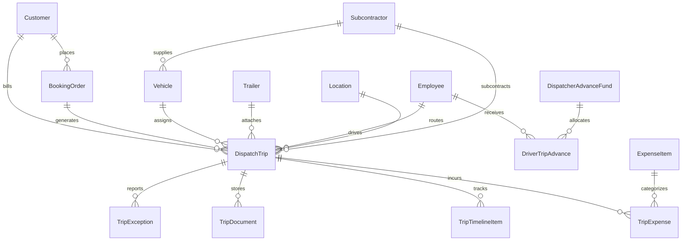

# GSS LOGISTICS — DATABASE SCHEMA & ORM ARCHITECTURE
## Data Layer Architecture & Relational Entity-Relationship Specification

> **Phiên bản:** v4.7.18 | **Cập nhật lần cuối:** 01/11/2026  
> **Hệ quản trị CSDL:** PostgreSQL 16 (Production) / SQLite3 (Development)  
> **Mô hình ORM:** Django 4.x ORM • Modular Monolith Architecture  
> **Tiêu chuẩn:** ISO/IEC/IEEE 42010 & Arc42 Section 8 (Data & Persistence Concept)

---

## 1. SƠ ĐỒ THỰC THỂ QUAN HỆ CỐT LÕI (CORE DOMAIN ERD)

---

## 2. NGUYÊN TẮC THIẾT KẾ CỐT LÕI

1. **Kế thừa Chuẩn mực:**
   - Mọi model kế thừa `TimeStampedModel` (`created_at`, `updated_at`).
   - Mọi model giao dịch, chứng từ kế thừa `SoftDeleteModel` (`is_deleted=True`, `deleted_at`).
2. **Nguyên tắc No Hard-Delete (Bảo vệ tính toàn vẹn pháp lý):**
   - Không cho phép gọi `.delete()` cứng trên dữ liệu vận đơn, chuyến xe và chi phí.
   - Khi xóa, hệ thống chuyển `is_deleted = True` và lưu vết thời gian.
3. **Bảo vệ Khóa ngoại an toàn (`on_delete=models.PROTECT`):**
   - Các bảng Khách hàng (`Customer`), Tài xế (`Employee`), Xe (`Vehicle`), Chuyến xe (`DispatchTrip`) liên kết với nhau bằng `PROTECT` để chống xóa dây chuyền gây mất dấu vết chứng từ.
4. **Denormalization via Signals (Tối ưu hiệu năng & Chống N+1):**
   - Các trường P&L chuyến (`cached_revenue`, `cached_expense`, `cached_profit`, `cached_margin_percent`) được tính toán và lưu trực tiếp trên bảng `DispatchTrip` mỗi khi chi phí phát sinh được duyệt.
5. **Đánh Index chính xác:**
   - Đánh chỉ mục kép và đơn trên các trường: `trip_code`, `container_number`, `booking_or_bill`, `license_plate`, `status`, `created_at`.

---

## 3. DANH MỤC CÁC PHÂN HỆ & BẢNG DỮ LIỆU (25 MODELS TRÊN 9 PHÂN HỆ)

### A. Phân hệ Nền tảng (`core`)
- `core.TrackingEventLog`: Lưu chuỗi sự kiện bất biến (Event Sourcing) cho mọi thay đổi trạng thái, tọa độ GPS và thao tác của điều độ/tài xế.

### B. Phân hệ Nhân sự & Tiền lương (`apps/personnel`)
- `personnel.Employee`: Quản lý hồ sơ nhân thân cá nhân 360° (độc lập với công ty), CCCD, MST cá nhân, số sổ BHXH, tài khoản ngân hàng chi lương, thông tin GPLX hạng C/FC/FE, người phụ thuộc giảm trừ gia cảnh. Tích hợp các Helper Properties tự động kế thừa chế độ kinh tế từ HĐLĐ hiện hành (`active_contract`).
- `personnel.EmployeeDependent`: Người phụ thuộc đăng ký giảm trừ gia cảnh thuế TNCN theo quy định (Nghị quyết 110/2025/UBTVQH15: 6.2tr/người/tháng).
- `personnel.LaborContract`: Hợp đồng lao động chuẩn GSS (Thử việc, Xác định thời hạn, Không xác định thời hạn, Thời vụ), lưu trữ các cam kết kinh tế: Lương CB, Lương BHXH, Phụ cấp cố định, Trợ cấp phúc lợi, Tổng thu nhập HĐ, Tỷ lệ hưởng lương %, Cờ tham gia BHXH (`is_social_insurance_participant`), Tính thuế TNCN (`is_taxable`), Đoàn viên Công đoàn (`is_union_member`), Phân loại cư trú thuế TNCN (`tax_resident_type`).
- `personnel.ContractAppendix`: Phụ lục hợp đồng lao động điều chỉnh mức lương chính, lương BHXH, phụ cấp, trợ cấp, phòng ban và chức vụ mới.
- `personnel.TaxBracket`: Biểu thuế TNCN lũy tiến từng phần (hỗ trợ Luật 109/2025/QH15 Biểu thuế 5 bậc từ 2026 và 7 bậc truyền thống) kèm số trừ nhanh chuẩn pháp luật Việt Nam.
- `personnel.SalaryDeductionRate`: Tỷ lệ trích nộp bảo hiểm bắt buộc và công đoàn (NLĐ: BHXH 8%, BHYT 1.5%, BHTN 1%, Đoàn phí 1%; Doanh nghiệp: BHXH 17.5%, BHYT 3%, BHTN 1%, KPCĐ 2%).
- `personnel.PayrollPolicyConfig`: Tham số giảm trừ gia cảnh (bản thân 15.5tr theo NQ 110/2025, NPT 6.2tr), ngày công chuẩn (26 ngày), trần đóng BHXH (50.8tr).
- `personnel.PayrollPeriod`: Kỳ tính lương hàng tháng (`YYYY-MM`), vòng đời 4 bước (`DRAFT ➔ REVIEWED ➔ LOCKED ➔ PAID`), liên thông Sổ Quỹ `CashTransaction`.
- `personnel.PayrollSlip`: Phiếu lương cá nhân chi tiết theo động cơ Hybrid Payroll kết nối HĐLĐ hiện hành (Lương thời gian theo tỷ lệ HĐ, Lương sản lượng chuyến `DispatchTrip`, Lương cắt kéo, Neo xe, Thưởng dầu, Phụ cấp HĐ, Trợ cấp HĐ, BHXH 10.5%, Đoàn phí CĐ 1%, Thuế TNCN đa chế độ, Khấu trừ tạm ứng `DriverTripAdvance`, Thực lĩnh Net).

### C. Phân hệ Quản lý Đội xe (`apps/fleet`)
- `fleet.Vehicle`: Quản lý đầu kéo, xe tải 10T, xe tải 2T. Hỗ trợ phân định xe nội bộ công ty TVL và xe đối tác 3PL/thầu phụ qua trường `subcontractor` (ForeignKey tới `master_data.Subcontractor`, `null=True, blank=True`). Lưu trữ thông tin đăng kiểm (`registration_expiry`, hỗ trợ nullable đối với xe ngoài), định kỳ bảo trì (`next_maintenance_date`), tài xế chỉ định, trạng thái hoạt động (`ACTIVE`, `IDLE`, `MAINTENANCE`).
- `fleet.Trailer`: Quản lý sơ-mi rơ-moóc 40ft, moóc cổ cò, moóc xương.

### D. Phân hệ Danh mục Dùng chung (`apps/master_data`)
- `master_data.Subcontractor`: Danh mục đối tác vận tải 3PL / thầu phụ / nhà xe ngoài, gara sửa chữa và nhà cung cấp vật tư (`partner_type`: CARRIER, GARAGE, SUPPLIER; mã số, tên viết tắt `short_name`, tên pháp nhân, MST, số điện thoại, địa chỉ công ty `address`, người liên hệ, tài khoản ngân hàng, cờ kích hoạt).
- `master_data.SubcontractorDriver`: Danh bạ tài xế thuộc đối tác 3PL (`subcontractor`, `full_name`, `phone`, `license_number`, `is_active`, `notes`). Quản lý tập trung theo pháp nhân đối tác vận tải, cách ly tuyệt đối khỏi nhân sự nội bộ `personnel.Employee`.
- `master_data.Location`: Danh mục cảng biển, ICD, Depot bãi rỗng và Kho nhà máy khách hàng chuẩn hóa (`LocationType`: PORT, ICD, DEPOT, WAREHOUSE, YARD).
- `master_data.ContainerType`: Quy cách container và thùng xe tải (20DC, 40HC, 45G1...), chuẩn hóa hệ số TEU, CBM và tải trọng payload kg.
- `master_data.ExpenseItem`: Danh mục động các khoản mục chi phí phát sinh hiện trường (`ExpenseCategoryGroup`: LIFT_ON, LIFT_OFF, TOLL, DEPOSIT, WEIGHING, LABOR, EINVOICE, OTHER).
- `master_data.DriverSalaryTariff`: Biểu phí lương chuyến tài xế phân nhóm theo khu vực kho và tuyến vận chuyển.
- `master_data.DriverAllowanceCatalog`: Danh mục phụ cấp cảng xa, kiểm hóa và tác nghiệp đặc thù.

### E. Phân hệ Khách hàng & Báo giá (`apps/customers`)
- `customers.Customer`: Danh bạ khách hàng doanh nghiệp, tên viết tắt / tên giao dịch (`short_name`), mã số thuế, địa chỉ, người liên hệ, số điện thoại, ghi chú.
- `customers.RouteTariff`: Biểu cước theo từng tuyến đường, chuẩn hóa liên kết ForeignKey tới `master_data.Location` (`pickup_loc`, `delivery_loc`, `dropoff_loc`), đơn giá cước xuất hóa đơn và định mức lương chuyến tài xế.
- `customers.Quotation`: Quản lý báo giá và phễu khách hàng (CRM).
- `customers.BookingOrder`: Đơn hàng đặt xe / Booking tiếp nhận từ Sales/CS; chuẩn hóa lộ trình 3 điểm với ForeignKey `master_data.Location`. Đính kèm tệp tin gốc `booking_file` (`FileField` hỗ trợ PDF/Ảnh $\le 5\text{MB}$ có kiểm tra Magic Bytes và Pillow).

### F. Phân hệ Điều độ Vận tải (`apps/dispatch`)
- `dispatch.DispatchTrip`: Bảng hạt nhân điều hành chuyến xe. Hỗ trợ điều phối linh hoạt cả Xe Nhà (TVL) và Xe Ngoài / Đối tác 3PL (`subcontractor`, `subcontractor_driver`, `subcontractor_driver_name`, `subcontractor_driver_phone`, `subcontractor_cost`, `subcontractor_advance`). Thuộc tính dynamic `assigned_driver_name`, `assigned_driver_phone`, `carrier_name`. Khi điều xe 3PL, `driver` (nội bộ) là `None` giúp cách ly hoàn toàn khỏi bảng tính lương nhân sự nội bộ. Chứa toàn bộ thông tin về loại hình (Nhập/Xuất/Nội địa), số Cont, loại Cont/Xe (`45G1`, `40HC`, `40GP`, `22GP`, `2x20DC`, xe tải `1T` - `15T`), số Seal, Booking/Bill, hạn Cắt Máng CY / Giờ SI, thông tin phiếu EIR (`eir_number`), hãng tàu (`shipping_line`), tên tàu/số chuyến (`vessel_voyage`), cảng đích (`destination_port`), trọng lượng VGM (`vgm_weight`), vị trí bãi cont (`bay_location`), 3 điểm lộ trình chuẩn hóa liên kết ForeignKey tới `master_data.Location` (`pickup_loc`, `warehouse_loc`, `dropoff_loc`), các mốc thời gian chuẩn hóa `DateTimeField` (`actual_gate_in_at`, `actual_gate_out_at`), và máy trạng thái 10 bước.
  - **Tệp tin đính kèm Booking (`booking_file`):** Lưu trữ file booking / lệnh cấp rỗng từ khách hàng hoặc kế thừa từ `BookingOrder`.
  - **Nghiệp vụ Cắt Kéo (Drop & Hook):** `is_split_trip`, `dropoff_driver`, `dropoff_vehicle`, `dropoff_trailer`, `driver_split_ratio`, `driver_allowance`, `dropoff_driver_allowance`.
  - **Nghiệp vụ Chở Ghép 2 Cont 20ft (Twin 20ft Drayage):** `is_twin_container`, `container_number_2`, `seal_number_2`, `booking_or_bill_2`, `vgm_weight_2`, `cargo_notes_2`.
  - **Quản lý Hạn Free DEM/DET & Giám định EIR:** `det_free_days`, `dem_free_days`, `det_expiry_date`, `dem_expiry_date`, `container_condition` (`GOOD`, `DAMAGED`, `CLEANING_REQUIRED`), `damage_description`.
- `dispatch.TripTimelineItem`: Chi tiết các mốc tiến độ thực tế theo thời gian.

### G. Phân hệ Chứng từ Số & OCR (`apps/documents`)
- `documents.TripDocument`: Lưu trữ ảnh chụp phiếu EIR lấy cont, EIR hạ cont, biên bản giao nhận hàng (POD), phiếu cân xe, hóa đơn nâng hạ, và file Booking / Lệnh cấp rỗng (`BOOKING_NOTE`) kèm kết quả nhận diện OCR AI. Tự động sinh bản ghi chứng từ khi chuyến xe có file booking đính kèm.

### H. Phân hệ Chi phí & Đối chiếu (`apps/billing`)
- `billing.TripExpense`: Chi phí phát sinh hiện trường liên kết trực tiếp tới `master_data.ExpenseItem` (`expense_item`) và tương thích ngược với 8 danh mục Bảng Kê Chi Phí GSS (`category`). Hỗ trợ phân loại 3 dòng chi phí chuẩn tài xế (`expense_payer_type`: TVL_COST, TVL_OBH, SUB_OBH), cờ hoàn chi hộ cho nhà xe thầu phụ `reimburse_to_subcontractor`, cờ thu hộ/chi hộ khách hàng `is_on_behalf_of_customer`, lưu trữ đầy đủ metadata hóa đơn điện tử: đơn vị phát hành (`invoice_issuer`), số hóa đơn (`invoice_number`), mã tra cứu (`invoice_lookup_code`), link tra cứu online (`invoice_lookup_url`), tiền trước thuế, thuế suất và tiền thuế GTGT. Tự động tính tổng chi phí và cập nhật P&L chuyến xe.
- `billing.DispatcherAdvanceFund`: Quỹ tạm ứng Cấp 1 cấp cho Điều phối viên để điều hành đội xe.
- `billing.DriverTripAdvance`: Quỹ tạm ứng Cấp 2 cấp cho Tài xế theo từng chuyến xe.
- `billing.CashTransaction`: Sổ quỹ dòng tiền Thu - Chi tổng hợp (Mẫu S03a-DN), hỗ trợ thu cước, chi thầu phụ, nạp ETC, tiền mặt và ngân hàng.
- `billing.CustomerInvoice`: Bảng Kê Vận Chuyển & Hóa Đơn Khách Hàng (Accounts Receivable - AR). Gom nhiều chuyến xe (`DispatchTrip`) và các khoản chi hộ trong kỳ đối soát của 1 Khách hàng; quản lý hạn nợ, thuế VAT, tiền đã trả và khóa sổ kế toán.
- `billing.SubcontractorSettlement`: Bảng Kê Đối Soát Nhà Xe Thầu Phụ / Xe Bạn (Accounts Payable - AP). Gom các chuyến xe chạy thuê ngoài để chốt công nợ phải trả cho Đối tác 3PL (TK 331), tự động trừ tạm ứng đã cấp.
- `billing.DriverPayrollSettlement`: Bảng Chốt Lương Chuyến & Quyết Toán Thu Nhập Tài Xế (Payroll Settlement). Cố định thu nhập theo kỳ, lương khoán chuyến, phụ cấp qua đêm, thưởng phạt và trừ tạm ứng tồn.
- `billing.DebitNote`: Bảng Kê Chi Hộ Riêng Biệt (Debit Note). Tập hợp các khoản `TripExpense` có cờ `is_on_behalf_of_customer` để gửi chủ hàng thu tiền hoàn ứng.

### I. Phân hệ Xử lý Sự cố (`apps/exceptions`)
- `exceptions.TripException`: Ghi nhận sự cố kẹt cảng, kẹt kho, vỏ cont hư hỏng, va chạm tai nạn kèm mức độ nghiêm trọng và phương án xử lý.

