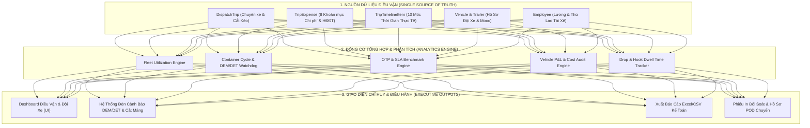
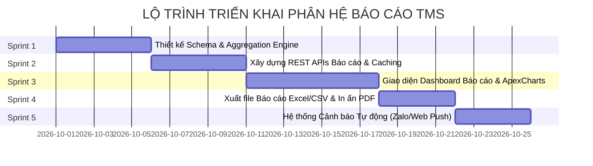

# KẾ HOẠCH PHÁT TRIỂN HỆ THỐNG BÁO CÁO & ĐIỀU VẬN NÂNG CAO (TMS ADVANCED ROADMAP)
> **Dự án:** BIM Logistics Platform — Nền tảng Quản trị Vận tải & Chuỗi cung ứng (Triền Võ Logistics)  
> **Phiên bản tài liệu:** 1.0  
> **Ngày lập:** 25/09/2026  
> **Trạng thái:** Sẵn sàng thực thi (Ready for Execution)

---

## 1. TỔNG QUAN & TẦM NHÌN CHIẾN LƯỢC (EXECUTIVE SUMMARY)

Sau khi hoàn tất chuẩn hóa quy trình phát lệnh điều động, quản lý hành trình 10 bước, nghiệp vụ **Cắt Kéo / Cắt Mooc (Drop & Hook - 2 Chặng)** và **Bảng kê chi phí 8 mục đối soát theo đầu xe & tài xế**, phân hệ **Điều vận (TMS)** cần được nâng cấp hệ thống phân tích dữ liệu và báo cáo quản trị chuyên sâu.

### Mục tiêu cốt lõi
1. **Minh bạch hóa dòng tiền & chi phí:** Mỗi đầu xe (Tractor) và chuyến xe (Trip) trở thành một "Trung tâm lợi nhuận con" (Profit Center), tách bạch tuyệt đối chi phí vận hành công ty và các khoản chi hộ khách hàng.
2. **Ngăn chặn rủi ro tổn thất lớn:** Cảnh báo sớm hạn miễn phí vỏ container (Free-time), triệt tiêu nguy cơ phát sinh tiền phạt lưu bãi/lưu vỏ hãng tàu (**DEM/DET** từ \$20 - \$80/ngày/cont).
3. **Tối ưu hóa năng suất tài sản cố định:** Giám sát tỷ lệ tận dụng xe nhà vs. xe thuê ngoài (3PL), tỷ lệ chạy rỗng một chiều, và thời gian chờ rơ-moóc tại kho khách hàng.
4. **Chuẩn mực hóa chất lượng cam kết (SLA):** Đo lường tỷ lệ đúng giờ (OTP) từng khâu, phân tích nút thắt cổ chai cảng biển/kho bãi và quản lý sự cố vận tải (OS&D) theo Luật Thương mại 2005.

---

## 2. DANH MỤC 6 BÁO CÁO QUẢN TRỊ CHUẨN TMS

---

### BÁO CÁO 1: BÁO CÁO HIỆU SUẤT ĐỘI XE & TÀI XẾ (FLEET & DRIVER UTILIZATION)

* **Đối tượng sử dụng:** Giám đốc Vận tải, Trưởng phòng Điều vận, Quản lý Đội xe.
* **Mục đích:** Trả lời câu hỏi: *"Đội xe đang vận hành hết công suất chưa hay nằm bãi? Xe nhà đã khai thác tối đa trước khi thuê thầu phụ ngoài chưa?"*.

#### Các chỉ số phân tích chính (KPIs):
1. **Sản lượng theo thời gian (Time Dimension):**
   - **Theo Ngày:** Số xe đang lăn bánh có hàng, số xe nằm bãi chờ lệnh (*Idle*), số xe đang bảo dưỡng/sửa chữa (*Maintenance*).
   - **Theo Tuần / Tháng:** Số chuyến bình quân đạt được trên mỗi đầu kéo (Định mức tiêu chuẩn: 25 - 35 chuyến/tháng cho cự ly nội tỉnh < 80km; 15 - 22 chuyến/tháng cho cự ly liên tỉnh 100 - 250km).
   - **Theo Quý / Năm:** Đánh giá nhịp độ theo mùa vụ logistics xuất nhập khẩu (Mùa cao điểm Q3 - Q4 vs. Thấp điểm Q1 sau Tết).
2. **Cơ cấu khai thác nguồn lực (Capacity Utilization):**
   - **Tỷ lệ Xe Nhà vs. Xe Bạn (3PL):**
     $$\text{Tỷ lệ Xe Nhà} = \frac{\text{Số chuyến Xe Nhà thực hiện}}{\text{Tổng số chuyến điều động}} \times 100\%$$
     *(Mục tiêu: Đạt $\ge 80\%$; tự động gắn cờ cảnh báo lãng phí nếu xe nhà còn trống mà điều độ thuê ngoài).*
   - **Tỷ lệ Chạy Có Tải vs. Chạy Rỗng (Laden vs. Empty Miles):** Giám sát tỷ lệ quay đầu xe, ghép chuyến 2 chiều (hạ cont nhập, bốc cont rỗng gần đó kéo về cảng xuất).
   - **Tỷ lệ Chuyến Chạy Thẳng vs. Chuyến Cắt Kéo (Drop & Hook):** Đánh giá hiệu quả tăng vòng quay xe khi áp dụng cắt mooc.
3. **Bảng P&L Từng Đầu Xe (Vehicle Profit Center):**
   $$\text{Lợi Nhuận Ròng Đầu Xe} = \text{Doanh Thu Chuyến} - (\text{Lương Tài Xế} + \text{Dầu DO} + \text{Vé BOT} + \text{Chi Phí Nâng Hạ} + \text{Sửa Chữa / Lốp})$$
   - Xếp hạng Top 5 đầu xe có tỷ suất sinh lời cao nhất và phát hiện đầu xe ngốn chi phí sửa chữa bất thường.
4. **Hiệu suất & Xếp hạng Tài xế (Driver Performance Scorecard):**
   - Số chuyến hoàn thành, doanh thu tạo ra, tỷ lệ giao hàng đúng hẹn (OTP), mức độ tiết kiệm dầu so với định mức, và điểm chấp hành an toàn giao thông.

---

### BÁO CÁO 2: CHU TRÌNH VỎ CONTAINER & CẢNH BÁO PHẠT HÃNG TÀU (DEM/DET MONITORING)

* **Đối tượng sử dụng:** Điều độ viên, Nhân viên Quản lý Vỏ cont, Kế toán theo dõi cược cont.
* **Mục đích:** Kiểm soát tuyệt đối đường đi của từng vỏ container, triệt tiêu tiền phạt lưu bãi/lưu cont hãng tàu (Demurrage & Detention).

#### Cơ chế hoạt động & Chỉ số:
1. **Theo dõi vị trí thời gian thực:**
   - Cont đang lấy tại Cảng/Depot $\rightarrow$ Đang di chuyển trên đường $\rightarrow$ Đang nằm tại bãi đệm Triền Võ $\rightarrow$ Đang cắt mooc tại kho khách $\rightarrow$ Đã hạ bãi rỗng/cảng chỉ định.
2. **Hệ thống Đèn Giao Thông Cảnh Báo Free-Time:**
   - 🟢 **Màu Xanh (An Toàn):** Còn hạn Free-time $> 48$ giờ.
   - 🟡 **Màu Vàng (Cảnh Báo):** Còn hạn Free-time $\le 24$ giờ $\rightarrow$ Đẩy thông báo lên màn hình điều vận ưu tiên xếp xe hạ cont.
   - 🔴 **Màu Đỏ (Khẩn Cấp):** Đã quá hạn Free-time $\rightarrow$ Bắt đầu đếm số ngày phạt và ước tính số tiền bồi hoàn hãng tàu (\$20 - \$80/ngày).
3. **Theo dõi hoàn tiền cược cont (Container Deposit Recovery):**
   - Đối chiếu phiếu thu cược cont vỏ hãng tàu với biên bản giám định hạ rỗng, đốc thúc lấy lại tiền cược không để bị giam vốn.

---

### BÁO CÁO 3: ĐÚNG GIỜ & CHẤT LƯỢNG DỊCH VỤ CAM KẾT (ON-TIME PERFORMANCE - OTP)

* **Đối tượng sử dụng:** Ban Giám Đốc, Bộ phận CSKH, Trưởng phòng Vận hành.
* **Mục đích:** Đo lường độ tin cậy dịch vụ của Triền Võ đối với các chủ hàng lớn (SAMSUNG, P&G, Unilever, Lotte...).

#### 3 Mốc Đo Lường Cốt Tử (SLA Milestones):
1. **Lấy Cont Đúng Giờ (Pickup On-Time):** Đúng giờ mở cổng Depot/Cảng, hoàn tất thủ tục EIR điện tử.
2. **Đến Kho Đúng Hẹn (Dock Arrival On-Time):** Xe có mặt tại cổng nhà máy khách hàng đúng khung giờ đã đăng ký (tránh bị phạt xếp hàng chờ hoặc trễ lịch đóng dỡ).
3. **Hạ Cảng Trước Giờ Cắt Máng (CY Closing Cutoff On-Time):** Yếu tố sống còn với hàng xuất khẩu; đảm bảo container vào bãi trước giờ tàu đóng sổ kiểm soát (Closing Time).
4. **Phân tích nguyên nhân sự cố trễ chuyến (Delay Root Cause):**
   - Kẹt xe QL51 / Cầu Phú Mỹ / Đường Nguyễn Thị Định.
   - Ùn tắc cổng Cảng Cát Lái / SP-PSA / Gemalink.
   - Kho khách lên hàng trễ / thiếu nhân công bốc dỡ.
   - Trục trặc giấy tờ Hải quan / Thủ tục kiểm hóa.

---

### BÁO CÁO 4: ĐỐI SOÁT CHI PHÍ TUYẾN & THU HỒI KHOẢN CHI HỘ (EXPENSE & REIMBURSEMENT)

* **Đối tượng sử dụng:** Kế toán Chi phí, Kế toán Công nợ Khách hàng, Giám đốc Tài chính (CFO).
* **Mục đích:** Kiểm soát tính hợp lý của chi phí phát sinh, minh bạch hóa việc hoàn ứng tiền vé BOT và thu hồi tiền chi hộ khách.

#### Nội dung nghiệp vụ:
1. **Đối soát Chi phí Tuyến vs. Định mức:**
   - So sánh tiền vé BOT (ePass/VETC) thực tế tài xế kê khai với định mức tuyến chuẩn (ví dụ: Tuyến *Cát Lái ➔ KCN Sóng Thần* có định mức vé BOT cố định).
   - Phát hiện các khoản chênh lệch bất thường cần giải trình.
2. **Báo cáo Thu hồi Khoản Chi Hộ Khách Hàng (Reimbursable Expenses):**
   - Tổng hợp các khoản công ty đã ứng chi trước: Phí nâng hạ cont phụ, phí cân điện tử, phí vệ sinh/sửa chữa vỏ cont, phí kiểm dịch thực vật.
   - Tự động kết xuất bảng kê phụ phí đính kèm hóa đơn cước vận chuyển để thu hồi tiền từ khách hàng, bảo toàn dòng tiền lưu động.

---

### BÁO CÁO 5: BÀN GIAO CẮT KÉO & LƯU MOOC TẠI KHO (DROP & HOOK DWELL TIME)

* **Đối tượng sử dụng:** Điều độ viên, Quản lý Rơ-moóc.
* **Mục đích:** Tối ưu hóa chu trình quay vòng rơ-moóc, chống tình trạng kho khách hàng "ngâm" mooc làm kho chứa tạm.

#### Nội dung nghiệp vụ:
1. **Đo lường thời gian lưu rơ-moóc (Dwell Time):**
   - Ghi nhận thời điểm Chặng 1 cắt mooc tại kho $\rightarrow$ Thời điểm Chặng 2 móc mooc kéo đi.
   - Thời gian tiêu chuẩn: Dưới 12 giờ.
2. **Cảnh báo ngâm mooc quá hạn:**
   - Cảnh báo khi mooc lưu tại kho quá 24h - 48h.
   - Tự động kích hoạt tính phí lưu mooc / lưu ca xe theo điều khoản hợp đồng vận chuyển.

---

### BÁO CÁO 6: NGOẠI LỆ & BỒI THƯỜNG HÀNG HÓA HIỆN TRƯỜNG (EXCEPTION & OS&D)

* **Đối tượng sử dụng:** Bộ phận Pháp chế, CSKH, Điều độ, Đội ngũ Giám định.
* **Mục đích:** Quản lý sự cố Over, Short, Damage theo chuẩn pháp lý vận tải Việt Nam.

#### Nội dung nghiệp vụ:
1. **Ghi nhận sự cố kèm hình ảnh hiện trường:**
   - Vỏ cont bị rách bạt, thủng nóc, móp méo tại bãi giao.
   - Seal hãng tàu bị đứt, sai lệch số ký hiệu so với Booking/Vận đơn.
   - Hàng hóa bên trong bị ướt, đổ vỡ, hư hỏng trong quá trình dỡ hàng.
2. **Quy trình lập biên bản bất thường:**
   - Lập biên bản hiện trường có chữ ký xác nhận 3 bên (Tài xế - Đại diện kho khách - Giám định viên).
   - Truy xuất hồ sơ giải quyết khiếu nại bồi thường bảo hiểm.

---

## 3. LỘ TRÌNH KỸ THUẬT TRIỂN KHAI (5-SPRINT TECHNICAL ROADMAP)

---

### SPRINT 1: DATA AGGREGATION & SERVICE LAYER (BACKEND NỀN TẢNG)
* **Nhiệm vụ:**
  - Xây dựng module `apps/reports/` hoặc mở rộng service trong `apps/dispatch/services.py`.
  - Thiết kế các query tối ưu (sử dụng PostgreSQL Window Functions, `TruncDate`, `TruncMonth`, `Count`, `Sum`, `Case-When`) để không bị chậm khi dữ liệu hàng nghìn chuyến xe.
  - Xây dựng model lưu trữ cấu hình cảnh báo Free-Time (`ContainerFreeTimeRule`) theo từng hãng tàu (Maersk, ONE, Cosco...).

### SPRINT 2: REST APIS BÁO CÁO ĐA CHIỀU (`/api/reports/...`)
* **Nhiệm vụ:**
  - `GET /api/reports/fleet-utilization/`: Trả về số liệu hiệu suất xe theo ngày/tháng, số chuyến, cơ cấu xe nhà/xe bạn.
  - `GET /api/reports/container-cycle/`: Trả về danh sách vỏ cont, trạng thái vị trí, số ngày lưu và mức cảnh báo DEM/DET.
  - `GET /api/reports/on-time-performance/`: Trả về tỷ lệ OTP, các chuyến trễ giờ và phân loại nguyên nhân.
  - `GET /api/reports/route-expenses/`: Trả về đối soát BOT và bảng kê thu hồi khoản chi hộ khách hàng.
  - `GET /api/reports/drop-hook-dwell/`: Trả về danh sách rơ-moóc đang nằm kho khách và thời gian lưu.

### SPRINT 3: GIAO DIỆN CHỈ HUY & TRỰC QUAN HÓA (UI/UX DASHBOARDS)
* **Nhiệm vụ:**
  - Bổ sung menu điều hướng **"Báo Cáo & Phân Tích"** trên Sidebar và Topbar.
  - Thiết kế màn hình báo cáo dạng Tab:
    - Tab 1: *Hiệu suất Đội xe & Xe Nhà/Xe Bạn*.
    - Tab 2: *Vỏ Cont & Cảnh Báo DEM/DET*.
    - Tab 3: *Đúng Giờ & Chất Lượng Dịch Vụ (OTP)*.
    - Tab 4: *Chi Phí Tuyến & Hoàn Chi Hộ*.
  - Tích hợp biểu đồ trực quan (Biểu đồ cột chồng, Biểu đồ đường xu hướng, Đồng hồ đo công suất Gauge).
  - Tuân thủ nghiêm ngặt Design Token hệ thống BIM: Màu Teal chủ đạo (`#0f766e`), Emerald thành công, Amber cảnh báo hạn, Rose nguy cấp quá hạn.

### SPRINT 4: TÍNH NĂNG XUẤT DỮ LIỆU EXCEL & IN ẤN BIỂU MẪU CHUẨN
* **Nhiệm vụ:**
  - Tích hợp xuất file Excel (`openpyxl` / `xlsx`) định dạng chuẩn kế toán Việt Nam: Tiêu đề công ty Triền Võ, có kẻ bảng, định dạng số tiền VNĐ và phân trang rõ ràng.
  - Hỗ trợ in ấn hoặc xuất PDF: Bảng kê chi phí đối soát chuyến xe, Biên bản giao nhận POD kèm hình ảnh OCR.

### SPRINT 5: TỰ ĐỘNG HÓA CẢNH BÁO TỨC THÌ (PROACTIVE ALERTING)
* **Nhiệm vụ:**
  - Hệ thống tự động quét mỗi 30 phút:
    - Phát hiện vỏ cont còn hạn $< 24$h.
    - Phát hiện chuyến xe chưa hạ bãi khi cách giờ Cắt Máng (Cutoff) $< 2$ giờ.
  - Đẩy thông báo chuông (Notification Bell) trên Topbar web app và gửi tin nhắn cảnh báo qua Zalo/Telegram đến Trưởng phòng Điều vận.

---

## 4. QUY CHUẨN KỸ THUẬT & TOÀN VẸN DỮ LIỆU (COMPLIANCE)

1. **Bảo tồn chuỗi kiểm toán (Traceability Sanctity):** Tuyệt đối không dùng lệnh xóa cứng (`.delete()`) trên dữ liệu mốc thời gian và chi phí; toàn bộ dữ liệu lịch sử phục vụ đối soát pháp lý.
2. **Tối ưu hóa hiệu năng truy vấn:**
   - Toàn bộ các bảng `DispatchTrip`, `TripTimelineItem`, `TripExpense` được đánh composite index trên các trường `(trip_code, created_at)`, `(status, is_deleted)`.
   - Sử dụng Redis cache cho các chỉ số KPI trên Dashboard cấp cao (TTL = 5 - 15 phút), tự động vô hiệu hóa cache (cache invalidation) khi có chuyến xe mới hoặc cập nhật chi phí.
3. **Thao tác thân thiện chuẩn 2 chạm:** Giao diện xem báo cáo cho phép lọc nhanh *Hôm nay*, *Tuần này*, *Tháng này*, *Theo Khách hàng* hoặc *Theo Đầu xe* chỉ trong 1 thao tác bấm.

---

## 5. KẾT LUẬN & SẴN SÀNG TRIỂN KHAI

Tài liệu này đã đúc kết đầy đủ toàn bộ yêu cầu, phân tích nghiệp vụ thực tế và thiết kế kiến trúc chuẩn TMS cho Triền Võ Logistics. Khi bắt đầu triển khai, đội ngũ kỹ thuật có thể mở file này và kích hoạt thực hiện tuần tự từ **Sprint 1** đến **Sprint 5**.
