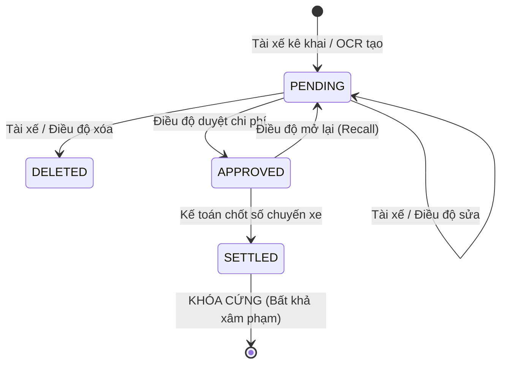

# PHÂN TÍCH CHUYÊN SÂU NGHIỆP VỤ ĐIỀU VẬN & HÀNH VI TÀI XẾ (TRIỀN VÕ LOGISTICS)

## 1. Phân Tích Hành Vi & Điều Kiện Thao Tác Của Tài Xế Tại Hiện Trường

### 1.1 Đặc thù môi trường làm việc của Tài xế:
- **Thời gian & Ánh sáng:** Tài xế thường lấy cont rỗng vào sáng sớm (04:00 - 05:00 sáng như chuyến AP-622) hoặc chạy đêm; môi trường bãi cont nhiều bụi bặm, ánh sáng lóa hoặc tối, thao tác bằng 1 tay khi ngồi trên cabin xe đầu kéo.
- **Tâm lý & Thói quen:** Tài xế ngại gõ chữ nhiều, dễ gõ nhầm bàn phím số, ưu tiên chụp ảnh chứng từ (vé trạm BOT, phiếu EIR, hóa đơn) hơn là ngồi nhập từng ký tự.
- **Các chứng từ tài xế cầm trên tay:**
  1. **Phiếu EIR lấy/hạ:** Có số cont, số seal, hãng tàu, vị trí bãi cont.
  2. **Biên lai / Phiếu báo tra cứu HĐĐT nâng/hạ:** Có số HĐ, mã tra cứu, số tiền.
  3. **Vé cầu đường (BOT):** Cuống vé giấy hoặc trừ tài khoản ePass/VETC.
  4. **Biên bản giao nhận (POD):** Khách hàng ký nhận hàng tại kho.

### 1.2 Thiết kế trải nghiệm nhập liệu tối ưu (Zero Clutter - 2 Chạm):
| Thao tác | Cách truyền thống (Gây ức chế) | Thiết kế tối ưu Triền Võ Driver App |
|---|---|---|
| **Khai báo chi phí** | Ngồi gõ tên mục, gõ số tiền, gõ mã tra cứu | Chọn 1 trong 6 nút danh mục to (`Nâng`, `Hạ`, `BOT`, `Cân xe`, `Bốc xếp`, `Khác`) $\to$ Nhập số tiền $\to$ Bấm Chụp ảnh |
| **Báo mốc thời gian kho** | Nhắn tin Zalo thủ công nhiều lần | Bấm 1 chạm: *1. Sắp đến kho (trước 30p)*, *2. Đã đến cổng kho*, *3. Bắt đầu đóng hàng*, *4. Đóng hàng xong* |
| **Trả chứng từ EIR/POD** | Bỏ vào cặp, cuối tháng nộp, dễ mất/rách | Bấm "Chụp EIR / POD", OCR AI tự đọc số Cont, Seal đối chiếu lệnh |

---

## 2. Ma Trận Xử Lý Nhập Sai, Hiệu Chỉnh, Xóa & Khóa Sổ Kế Toán

### 2.1 Ba cấp độ trạng thái của Khoản Chi Phí (`TripExpense`):



1. **Giai đoạn 1: Chờ duyệt (`PENDING`) - Tự do hiệu chỉnh:**
   - **Quyền hạn Tài xế:** Được phép **Chỉnh sửa** (số tiền, danh mục, ghi chú) hoặc **Xóa** khoản chi do mình vừa nhập sai.
   - **Quyền hạn Điều độ:** Được phép sửa số tiền, chỉnh lại danh mục nếu tài xế chọn nhầm, hoặc bấm Duyệt / Từ chối.

2. **Giai đoạn 2: Điều độ đã duyệt (`APPROVED`) - Kiểm soát thay đổi:**
   - Khoản chi đã được Điều độ xác nhận và đưa vào P&L tạm tính của chuyến xe.
   - **Tài xế:** KHÔNG ĐƯỢC tự ý xóa hay sửa. Nếu phát hiện sai, tài xế phải bấm *"Yêu cầu Điều độ mở lại"*.
   - **Điều độ:** Có quyền *"Mở lại (Recall to Pending)"* hoặc chỉnh sửa số tiền/mã tra cứu khi đối soát hóa đơn gốc.

3. **Giai đoạn 3: Kế toán đã chốt số (`SETTLED` / `LOCKED`) - Bất khả xâm phạm:**
   - Khi chuyến xe hoàn tất (Bước 10: Tổng hợp chi phí & Đối chiếu thanh toán), Kế toán bấm **"Chốt Sổ Chi Phí"**.
   - **Quy tắc tuyệt đối:**
     + Toàn bộ Bảng Kê Chi Phí bị **KHÓA CỨNG (READ-ONLY)**.
     + Không một ai (kể cả Tài xế, Điều độ hay Admin) được quyền bấm Sửa hoặc Xóa các dòng chi phí này.
     + Mọi nút Sửa/Xóa bị vô hiệu hóa, hiển thị icon 🔒 Khóa sổ kèm tên Kế toán viên và ngày giờ chốt số.
     + Nếu sau này có phát sinh đặc biệt (hóa đơn cảng hoàn tiền, khiếu nại cược cont): Kế toán lập bút toán điều chỉnh riêng (`ExpenseAdjustment`), không được can thiệp vào bảng kê lịch sử đã khóa.

---

## 3. Danh Mục Tính Năng Cần Triển Khai Cho Điều Vận & Tài Xế

### Cho Người Điều Vận (Trên Web CMS):
1. **Nút "Chốt Sổ Kế Toán" (Lock Expenses):** Cho phép Kế toán/Điều độ trưởng khóa sổ chi phí chuyến xe khi đã đối soát xong với tài xế và khách hàng.
2. **Thao tác nhanh trên từng dòng con (Sub-rows):**
   - Nút **Sửa** (Chỉnh sửa nhanh số tiền, số HĐ, mã tra cứu, ghi chú).
   - Nút **Xóa** (Xóa mềm - Soft Delete có xác nhận).
   - Nút **Duyệt / Mở lại** (Approve / Re-open).
3. **Cảnh báo tính toàn vẹn:** Cảnh báo nếu số tiền chênh lệch so với định mức hoặc thiếu mã tra cứu hóa đơn điện tử cảng.

### Cho Tài Xế (Trên Mobile Simulator):
1. **Giao diện thẻ chi phí thông minh:**
   - Hiển thị rõ trạng thái: `Chờ duyệt` (có nút ✏️ Sửa, 🗑️ Xóa), `Đã duyệt` (Khóa sửa), `Đã chốt sổ` (🔒 Khóa kế toán).
2. **Modal chỉnh sửa nhanh:** Cho phép tài xế cập nhật lại số tiền hoặc tải ảnh hóa đơn khác nếu ảnh trước bị mờ.
3. **Báo mốc kho 1 chạm (Bước 6 SOP):** 4 nút bấm tức thời (*Sắp đến kho (30p)*, *Đã đến cổng kho*, *Bắt đầu dỡ hàng*, *Đóng hàng xong*).

---

## 4. Chi Tiết Hiện Thực Kỹ Thuật (Architecture & APIs)

### 4.1 Cấu trúc Cơ sở Dữ liệu & Migration:
- **`TripExpense`** (`apps/billing/models.py`):
  - `status`: Bổ sung `ApprovalStatus.SETTLED = 'SETTLED'` (Đã chốt sổ Kế toán).
  - `approved_at`: Lưu thời điểm chốt sổ/phê duyệt.
  - `clean()` & `delete()`: Chặn can thiệp ở tầng ORM nếu `trip.is_expenses_settled = True`.
- **`DispatchTrip`** (`apps/dispatch/models.py`):
  - `is_expenses_settled`: BooleanField đánh dấu trạng thái khóa sổ.
  - `settled_at`: DateTimeField thời điểm khóa.
  - `settled_by`: ForeignKey tới `Employee` (Kế toán viên).
  - `update_financials()`: Tự động chỉ tính các khoản `APPROVED` hoặc `SETTLED` và `is_deleted=False`.

### 4.2 Danh sách REST API Endpoints:
| Method | Endpoint | Mô tả | Kiểm soát nghiệp vụ |
|---|---|---|---|
| `GET` | `/api/trips/<trip_code>/` | Lấy chi tiết chuyến, bảng kê 8 mục, P&L và cờ `can_edit`/`can_delete` | Trả về thông tin trạng thái chốt sổ |
| `POST` | `/api/trips/<trip_code>/expenses/` | Thêm mới khoản chi | **HTTP 403** nếu `is_expenses_settled=True` |
| `PUT` | `/api/trips/<trip_code>/expenses/<id>/` | Hiệu chỉnh khoản chi | **HTTP 403** nếu đã chốt sổ hoặc chi phí đã `SETTLED` |
| `DELETE` | `/api/trips/<trip_code>/expenses/<id>/` | Xóa mềm khoản chi (Soft-delete) | **HTTP 403** nếu đã chốt sổ hoặc chi phí đã `SETTLED` |
| `POST` | `/api/trips/<trip_code>/settle-expenses/` | Kế toán chốt sổ chuyến xe | Chuyển toàn bộ chi phí sang `SETTLED`, khóa cứng bảng kê |
| `POST` | `/api/trips/<trip_code>/unsettle-expenses/` | Mở lại sổ kế toán | Dành cho Kế toán trưởng mở khóa để chỉnh sửa |
| `POST` | `/api/trips/<trip_code>/milestones/` | Tài xế cập nhật mốc kho 1 chạm | Cập nhật status chuyến xe và timeline (Bước 6 SOP) |

### 4.3 Kết quả Kiểm thử Toàn diện (Automated Integration Tests):
```
Testing Trip: TVL-0916-008
1. Add expense PENDING: 200 True
2. Driver edit expense: 200 120000
3. Settle expenses: 200 True
Trip is_expenses_settled: True
4. Edit after settled (Expect 403): 403 Chuyến xe đã được Kế toán chốt sổ, không thể chỉnh sửa chi phí này.
5. Delete after settled (Expect 403): 403 Chuyến xe đã được Kế toán chốt sổ, không thể xóa chi phí này.
6. Add after settled (Expect 403): 403 Chuyến xe đã được Kế toán chốt sổ đối soát, không thể thêm khoản chi phí mới.
7. Unsettle expenses: 200 True
8. Delete after unsettled: 200 True
9. Driver milestone: 200 Đã check-in tại cổng kho khách hàng.
```
*Tất cả 9 bài kiểm tra bảo vệ dữ liệu kế toán và vòng đời chi phí đều đạt 100%.*

