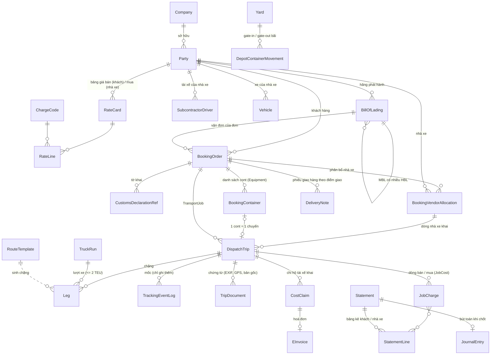

# Sơ đồ dữ liệu GSS TMS (sau GĐ0, 09/11/2026)

Sơ đồ dưới bám theo §4 của đặc tả, ghi tên model thật trong mã. Các cột chung không vẽ lại:
`company` (đa doanh nghiệp + RLS), `created_at` / `updated_at`, `is_deleted` (xoá mềm), `public_id` (UUIDv7, ở các bảng lộ ra ngoài).

## Ánh xạ khái niệm đặc tả → model

| Đặc tả §4 | Model | Ghi chú |
| :-- | :-- | :-- |
| Party | `master_data.Party` | một bảng, cờ vai trò; proxy `Customer`, `Subcontractor`, `ShippingLine` |
| Location, ContainerType, FreeTimeRule, DeliveryNoteTemplate | `master_data.Location`, `master_data.ContainerType`, `gss.FreeTimeRule`, `customers.PodTemplate` | |
| Vehicle / Chassis / Driver | `fleet.Vehicle`, `fleet.Trailer`, `master_data.SubcontractorDriver` | |
| ChargeCode, RateCard, RateLine | `gss.ChargeCode`, `gss.RateCard`, `gss.RateLine` | |
| BillOfLading (MBL ◄ HBL) | `gss.BillOfLading` | đồng bộ từ số MBL/HBL của đơn |
| Shipment | `customers.BookingOrder` | |
| CustomsDeclaration | `gss.CustomsDeclarationRef` | |
| Equipment | `gss.BookingContainer` | |
| TransportJob | `dispatch.DispatchTrip` | máy 7 bước GSS ở `step_status` |
| Leg, TruckRun, RouteTemplate | `gss.Leg`, `gss.TruckRun`, `gss.RouteTemplate` | |
| VendorAllocation, AccessGrant | `dispatch.BookingVendorAllocation` | token băm, hạn, thu hồi, khoá |
| TrackingEvent | `core.TrackingEventLog` | |
| StoredFile / DocumentLink | `documents.TripDocument` (+ `capture_meta`) | tên chuẩn sinh khi xem (`apps/gss/docs.py`) |
| GateTransaction | `depot_yard.DepotContainerMovement` | mỗi cont một lượt vào bãi chưa đóng |
| CostItem, EInvoice, JobCharge / JobCost, Statement, DeliveryNote | `gss.CostClaim`, `gss.EInvoice`, `gss.JobCharge` / proxy `gss.JobCost`, `gss.Statement`, `gss.DeliveryNote` | |
| Ledger | `ledger.*` | nguồn bút toán: chuyến, chi phí, hoá đơn, bảng kê |

## Chưa tách theo đặc tả (ghi nhận)

- `DispatchTrip` vẫn là tên model của TransportJob và còn các cột của mô hình chuyến cũ (máy trạng thái `status` 11 bước
  được giữ đồng bộ từ `step_status` cho báo cáo/sổ cái cũ).
- `JobCost` là proxy (cùng bảng với JobCharge, `side='BUY'`), chưa phải bảng riêng.
- Chưa có `StoredFile` / `FileDerivative` / `DocumentLink` tách bảng; `CargoItem` / `Stop` / `DeliveryDrop` (GĐ4, hàng lẻ).
