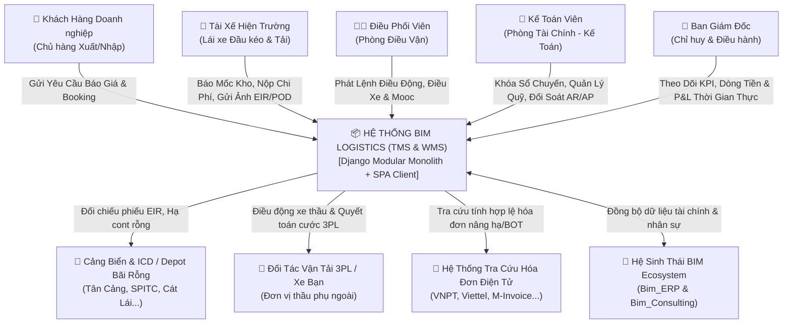
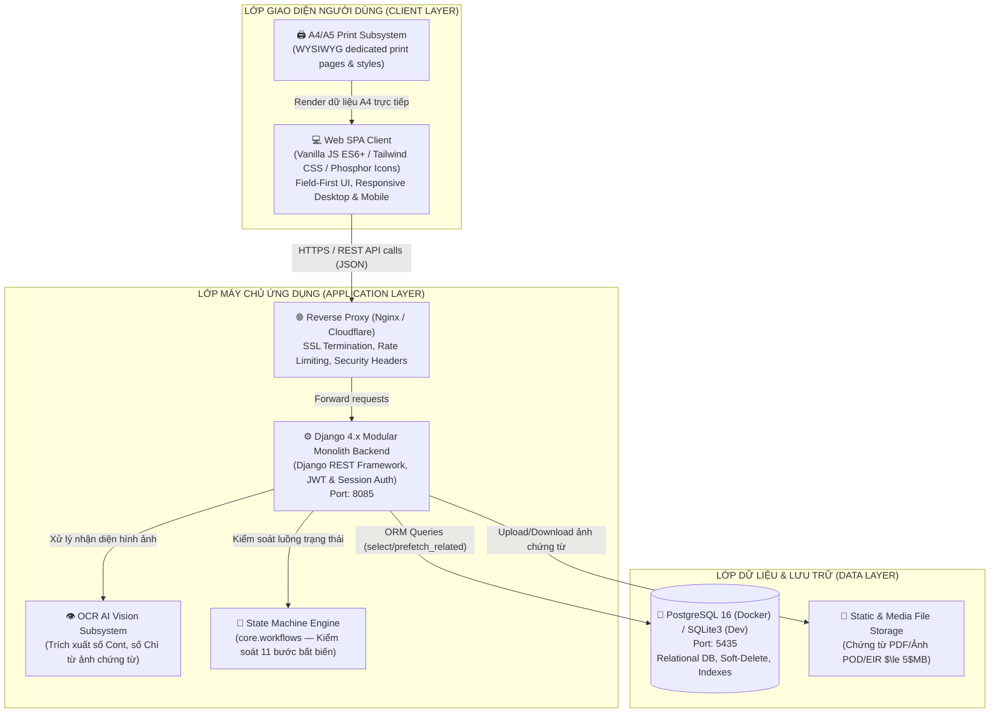

# BIM LOGISTICS PLATFORM — TỔNG QUAN KIẾN TRÚC HỆ THỐNG
## System Architecture & C4 Model Overview

> **Hệ thống:** BIM Logistics Platform (TMS & WMS)  
> **Tổ chức chủ quản:** Triền Võ Logistics (Thuộc hệ sinh thái BIM Ecosystem)  
> **Phiên bản:** v4.7.18 (Production)  
> **Cập nhật lần cuối:** 01/11/2026  
> **Tiêu chuẩn kiến trúc:** ISO/IEC/IEEE 42010, Arc42 Template & C4 Model  
> **Trạng thái:** Production-Ready

---

## 1. BỐI CẢNH VÀ MỤC TIÊU HỆ THỐNG (SYSTEM CONTEXT & GOALS)

### 1.1 Giới Thiệu Chung
**BIM Logistics** là nền tảng Quản trị Vận tải (TMS - Transportation Management System) và Quản trị Kho vận (WMS - Warehouse Management System) chuyên biệt cho ngành vận tải container FCL (Full Container Load), hàng rời LTL và vận tải đa phương thức tại Việt Nam.

Nền tảng đóng vai trò hạt nhân vận hành của **Triền Võ Logistics**, kết nối thông suốt giữa Ban Giám Đốc, Bộ phận Kinh doanh & Báo giá, Đội ngũ Điều độ Vận tải, Lái xe Hiện trường, Khách hàng Doanh nghiệp và các Đối tác vận tải thuê ngoài (3PL).

### 1.2 Bảng Mục Tiêu Kiến Trúc & Nghiệp Vụ
| Phân hệ / Bounded Context | Trách nhiệm Kiến trúc cốt lõi | Các chỉ số vận hành chính (KPIs) |
|---|---|---|
| **Điều Vận & Chuyến Xe (`dispatch`)** | Máy trạng thái 11 bước, Lộ trình 3 điểm, Cắt kéo (Drop & Hook), Ghép đôi 2 cont 20ft, Cảnh báo Free-time DEM/DET. | Vòng quay đầu xe, Tỷ lệ đúng giờ (OTP $\ge 95\%$), Tỷ lệ xe nhà khai thác ($\ge 80\%$). |
| **Tài Chính & Kế Toán (`billing`)** | Hạch toán Sổ Quỹ Thu - Chi (Mẫu S03a-DN), Bảng kê 8 khoản chi Triền Võ, Tạm ứng 2 cấp (Quỹ điều vận & Ứng chuyến), Bảng kê AR/AP. | Zero Variance P&L (Sai số 0đ), Thời gian chốt sổ chuyến xe $\le 24$h sau hoàn tất POD. |
| **Kinh Doanh & CRM (`customers`)** | Báo giá đa phương thức (theo chuyến, bậc thang, điều chỉnh giá dầu DO), Quản lý Booking đơn hàng, Phễu khách hàng. | Tỷ lệ chuyển đổi báo giá thành booking, Doanh thu kế hoạch vs. thực tế. |
| **Đội Xe & Thiết Bị (`fleet`)** | Quản trị hồ sơ Đầu kéo, Rơ-moóc, kiểm soát hạn đăng kiểm, bảo trì định kỳ, tỷ lệ xe nhà vs. xe thầu phụ 3PL. | Tỷ lệ xe sẵn sàng hoạt động ($\ge 90\%$), Tỷ lệ chạy rỗng một chiều ($\le 25\%$). |
| **Nhân Sự & Tiền Lương (`personnel`)** | Hồ sơ nhân sự 360°, HĐLĐ, Thuế TNCN (Luật 109/2025/QH15, NQ 110/2025), Động cơ tính lương Hybrid Payroll. | Thời gian chốt bảng lương tháng $\le 3$ ngày, Độ chính xác tính lương 100%. |
| **Chứng Từ Số & OCR AI (`documents`)** | Số hóa biên bản POD, phiếu EIR lấy/hạ, hóa đơn GTGT điện tử, AI OCR tự động trích xuất số Cont và số Chì (Seal). | Tỷ lệ trích xuất OCR chính xác $\ge 95\%$, Loại bỏ hoàn toàn thất lạc chứng từ gốc. |
| **Sự Cố Ngoại Lệ OS&D (`exceptions`)** | Ghi nhận kẹt cảng, kẹt kho, vỏ cont hư hỏng, va chạm tai nạn kèm mức độ nghiêm trọng và phương án xử lý điều độ. | Thời gian phản hồi xử lý sự cố $\le 15$ phút, Giảm thiểu phạt neo bãi. |
| **Dịch Vụ Hải Quan (`customs`)** | Phân luồng tờ khai thông quan Xanh / Vàng / Đỏ, liên kết với đơn vận chuyển hàng xuất nhập khẩu. | Tỷ lệ thông quan đúng hạn chuyến bay/tàu. |
| **Dashboard Ban Giám Đốc** | Bảng chỉ huy thời gian thực: Dòng tiền mặt, số dư ngân hàng, P&L chuyến xe, biểu đồ xu hướng doanh thu/chi phí. | Cập nhật tức thời (Zero Latency) qua Signals. |

---

## 2. BIỂU ĐỒ KIẾN TRÚC C4 MODEL (C4 ARCHITECTURE DIAGRAMS)

### 2.1 C4 Level 1: System Context Diagram (Bối Cảnh Hệ Thống)



### 2.2 C4 Level 2: Container Diagram (Kiến Trúc Thành Phần Chạy)



---

## 3. CẤU TRÚC THƯ MỤC CHUẨN MODULAR MONOLITH

```text
e:/Bim_Logistics/
├── apps/                               # Các phân hệ nghiệp vụ độc lập (Bounded Contexts)
│   ├── billing/                        # Quản trị Tài chính, Sổ Quỹ Thu - Chi, Chi phí & Đối soát
│   ├── customers/                      # CRM Khách hàng, Báo giá Đa phương thức, Booking Order
│   ├── customs/                        # Dịch vụ Hải quan & Phân luồng tờ khai
│   ├── dispatch/                       # Điều vận chuyến xe, Lộ trình 3 điểm, Cắt kéo, Timeline
│   ├── documents/                      # Quản lý chứng từ pháp lý số & Nhận diện OCR AI
│   ├── exceptions/                     # Ghi nhận & Xử lý sự cố bất thường (OS&D)
│   ├── fleet/                          # Quản trị Đội xe, Rơ-moóc, Hạn đăng kiểm & bảo trì
│   ├── master_data/                    # Danh mục Cảng/ICD/Kho, Biểu cước, Quy cách Cont, 3PL
│   └── personnel/                      # Nhân sự 360°, HĐLĐ, Thuế TNCN & Lương Hybrid Payroll
├── core/                               # Nền tảng dùng chung toàn hệ thống
│   ├── models/                         # BaseModel, TimeStampedModel, SoftDeleteModel
│   ├── workflows/                      # State Machine Engine cho đơn vận và chuyến xe
│   ├── audit/                          # TrackingEventLog (Event Sourcing)
│   └── security/                       # HashID chống IDOR, Simple JWT Helpers
├── docs/                               # Toàn bộ tài liệu kiến trúc & vận hành (Documentation-as-Code)
│   ├── README.md                       # Hub điều hướng toàn bộ hệ thống tài liệu kiến trúc
│   ├── AGENTS.md                       # Quy tắc hành vi kỹ thuật & Bản đồ kiến trúc cho AI (ISO 42010)
│   ├── CODING_STANDARDS.md             # Quy chuẩn Clean Architecture & Code Quality (ISO 25010)
│   ├── SECURITY_AUDIT.md               # 20 Tiêu chuẩn an ninh chuỗi cung ứng & Luật BV DLCN 91/2025
│   ├── PROJECT_OVERVIEW.md             # (File này) Tổng quan hệ thống, C4 Model & Cấu hình Hạ tầng
│   ├── FEATURES.md                     # Đặc tả 22 phân hệ tính năng & 25 Django models
│   ├── API_REFERENCE.md                # Tài liệu hợp đồng RESTful API đầy đủ
│   ├── DATABASE_SCHEMA.md              # Sơ đồ CSDL, ORM, Core ERD & chiến lược Indexing
│   ├── OPERATIONAL_WORKFLOW.md         # Quy trình điều vận 11 bước, State Machine & Vòng đời chi phí
│   ├── UI_UX_GUIDELINES.md             # Design Tokens BIM & Thang đo Typography 7 bậc
│   ├── DEVELOPMENT_PLAN.md             # Lộ trình TMS nâng cao, ADRs & On-Premise
│   ├── CHANGELOG.md                    # Nhật ký phát hành phiên bản (SemVer)
│   └── USER_GUIDE.md                   # Cẩm nang hướng dẫn sử dụng phần mềm cho người dùng cuối
├── scripts/                            # Tiện ích tự động hóa & Kiểm thử
│   ├── build_app_js.py                 # Engine đóng gói JS phân hệ sang static/js/app.js
│   └── run_migrations_and_tests.py     # Quy trình kiểm thử toàn diện
├── static/                             # Tài nguyên giao diện người dùng
│   ├── css/main.css                    # Design Tokens Tailwind & Custom ERP utilities
│   ├── js/
│   │   ├── app.js                      # Bundle JS SPA tự sinh (Source of Truth tại src/app/)
│   │   ├── column_manager.js           # Bộ điều khiển quản lý ẩn/hiện và sắp xếp cột bảng
│   │   └── src/app/                    # Mã nguồn JavaScript phân hệ theo cấu trúc module
├── templates/                          # Template Django HTML (Kiến trúc View Components)
│   ├── base.html                       # Khung HTML vỏ SPA
│   ├── index.html                      # Entry point ứng dụng
│   ├── components/                     # Modal biểu mẫu, Sidebar điều hướng, Topbar
│   └── views/                          # 14 Màn hình chức năng chuyên dụng
└── requirements.txt                    # Thư viện phụ thuộc Python Backend
```

---

## 4. BA QUY TẮC BẤT KHẢ XÂM PHẠM TRONG KIẾN TRÚC (ARCHITECTURAL INVARIANTS)

1. **No Hard-Delete on Legal Data (Bảo toàn lịch sử truy vết):**
   Mọi dữ liệu vận đơn, phiếu EIR, biên bản POD có chữ ký và sự cố bồi thường là chứng cứ pháp lý giải quyết tranh chấp. Tuyệt đối không dùng `.delete()` cứng, chỉ dùng Soft-Delete (`is_deleted=True`) kế thừa từ `SoftDeleteModel`.
2. **Zero Variance Financial Accounting (Chính xác tuyệt đối tài chính):**
   Số liệu P&L chuyến xe và đối soát sổ quỹ luôn bằng tổng đại số chi tiết của từng khoản mục chi phí được duyệt. Mọi thay đổi về chi phí đều tự động cập nhật cache tài chính trên bảng `DispatchTrip` qua Django Signals.
3. **Deterministic State Machine (Máy trạng thái đơn định):**
   Vòng đời chuyến xe trải qua 11 bước vận hành được quản lý tập trung qua `core.workflows`, ngăn chặn mọi hành vi nhảy cóc trạng thái trái quy luật vận tải.

---

## 5. CẤU HÌNH HẠ TẦNG & DỊCH VỤ TÍCH HỢP (INFRASTRUCTURE & INTEGRATIONS)

### 5.1 Cấu Hình Dịch Vụ Email Thông Báo (SMTP Email Service)
Hệ thống sử dụng dịch vụ email SMTP phục vụ 3 mục đích an ninh & vận hành:
- Gửi liên kết **đặt lại mật khẩu** cho nhân sự và khách hàng (`Quên mật khẩu`).
- Gửi thông báo xác nhận khi **mật khẩu vừa được thay đổi**.
- Cảnh báo an ninh khi phát hiện **đăng nhập từ thiết bị hoặc địa chỉ IP mạng mới**.

**Quy trình cấu hình trên máy chủ (VPS Production):**
1. **Khởi tạo Mật khẩu ứng dụng (Google App Password):**
   - Đăng nhập tài khoản email gửi thông báo (khuyến nghị: `noreply.trienvo@gmail.com` hoặc `noreply@trienvo.com`).
   - Mở Cài đặt bảo mật Google Account $\rightarrow$ Kích hoạt Xác minh 2 bước $\rightarrow$ Tạo Mật khẩu ứng dụng (App Password) 16 ký tự.
2. **Khai báo biến môi trường `.env` trên VPS:**
   ```bash
   EMAIL_HOST_USER=noreply.trienvo@gmail.com
   EMAIL_HOST_PASSWORD=abcdefghijklmnop      # 16 ký tự App Password viết liền
   EMAIL_BRAND_NAME=Triền Võ Logistics
   DEFAULT_FROM_EMAIL=Triền Võ Logistics <noreply.trienvo@gmail.com>
   ```
3. **Khởi động lại dịch vụ Container:**
   ```bash
   sudo docker compose up -d --force-recreate web
   ```

### 5.2 Cấu Hình Môi Trường Runtime & Ports
| Dịch vụ | Container Name | Port Nội Bộ | Port Công Khai | Ghi chú an ninh |
|---|---|---|---|---|
| **Web Application** | `bim_logistics_web` | 8000 | 8085 | Định tuyến qua Reverse Proxy Nginx, bật SSL/HTTPS |
| **Database Server** | `bim_logistics_db` | 5432 | 5435 (Local only) | Chỉ mở kết nối nội bộ trong mạng Docker, đóng Internet |
| **Cache Engine** | In-memory / Redis | 6379 | — | Lưu trữ tạm thời trạng thái và cache KPI Dashboard |
