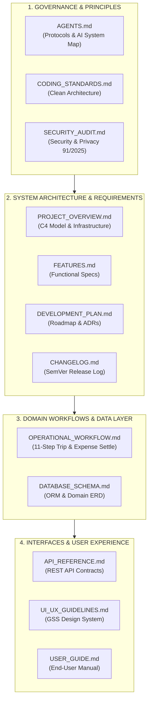

# TÀI LIỆU KIẾN TRÚC HỆ THỐNG GSS LOGISTICS (TMS & WMS PLATFORM)
## Architecture Documentation Hub & System Landscape

> **Hệ thống:** GSS Logistics Platform  
> **Đơn vị phát triển:** Green Solutions Smart (GSS)  
> **Phiên bản nền:** v4.7.19 (kế thừa từ BIM Logistics) · **Dự án:** GSS-TMS-2026 (repo `GSS_LOGISTICs`)  
> **Cập nhật lần cuối:** 01/11/2026  
> **Tiêu chuẩn tài liệu:** ISO/IEC/IEEE 42010, Arc42 Template & C4 Model  
> **Mô hình quản trị:** Documentation-as-Code

Thư mục `docs/` kết hợp cùng các tài liệu chỉ thị tại thư mục gốc tạo thành bộ đặc tả kiến trúc phần mềm hoàn chỉnh, tinh gọn và không trùng lặp cho nền tảng **GSS Logistics (GSS_LOGISTICs)**, phục vụ các bên liên quan: Ban Giám Đốc, Kiến trúc sư phần mềm, Lập trình viên và các AI Autonomous Agents.

---

## 🗺️ BẢN ĐỒ ĐIỀU HƯỚNG BỘ TÀI LIỆU KIẾN TRÚC ĐÃ CHUẨN HÓA

Toàn bộ hệ thống tài liệu được tái cấu trúc thành 4 nhóm nghiệp vụ chính:

### Bảng Danh Mục 14 Tài Liệu:

| STT | Tài liệu | Đường dẫn | Tiêu chuẩn & Trọng tâm nghiệp vụ |
|:---:|---|---|---|
| **01** | **Documentation Hub** | [`README.md`](README.md) | *(File này)* Cổng thông tin điều hướng toàn bộ hệ thống tài liệu kiến trúc phần mềm. |
| **02** | **Agent Governance & Map** | [`AGENTS.md`](AGENTS.md) | **[Hợp nhất GEMINI.md]** 4 quy tắc hành vi, kiểm chứng chất lượng, bảo toàn dữ liệu & bản đồ tra cứu tài liệu cho AI. |
| **03** | **Coding Standards** | [`CODING_STANDARDS.md`](CODING_STANDARDS.md) | Clean Architecture, Modular Monolith Django, ORM First, Defensive Backend chống lỗi 500, Design Tokens GSS. |
| **04** | **Security & Privacy** | [`SECURITY_AUDIT.md`](SECURITY_AUDIT.md) | 20 chuẩn an ninh chuỗi cung ứng + Tuân thủ Luật Bảo vệ dữ liệu cá nhân (số 91/2025/QH15 & NĐ 356/2025/NĐ-CP). |
| **05** | **System Overview & C4** | [`PROJECT_OVERVIEW.md`](PROJECT_OVERVIEW.md) | Kiến trúc C4 Level 1 & Level 2, Bounded Contexts + Cấu hình hạ tầng & Dịch vụ Email SMTP. |
| **06** | **Feature Specifications** | [`FEATURES.md`](FEATURES.md) | Đặc tả 22 phân hệ tính năng nghiệp vụ TMS/WMS, UI details, tổng hợp 25 Django Models thực tế. |
| **07** | **API Reference** | [`API_REFERENCE.md`](API_REFERENCE.md) | Hợp đồng giao tiếp RESTful API 9 phân hệ, Auth JWT/Session, schema payload, HTTP response & error codes. |
| **08** | **Database Schema** | [`DATABASE_SCHEMA.md`](DATABASE_SCHEMA.md) | Mô hình thực thể ERD 25 models, quan hệ khóa ngoại PROTECT, chiến lược Indexing và Denormalization Signals. |
| **09** | **Operational & Financial Workflow** | [`OPERATIONAL_WORKFLOW.md`](OPERATIONAL_WORKFLOW.md) | Chu trình điều vận 11 bước + Máy trạng thái chi phí (`PENDING` ➔ `APPROVED` ➔ `SETTLED`), Sổ quỹ S03a-DN & Tạm ứng 2 cấp. |
| **10** | **UI/UX Guidelines** | [`UI_UX_GUIDELINES.md`](UI_UX_GUIDELINES.md) | Triết lý Field-First, Design Tokens GSS, Thang đo Typography 7 bậc chuẩn ERP, thư viện component và 2-touch rule. |
| **11** | **Development Roadmap & ADRs** | [`DEVELOPMENT_PLAN.md`](DEVELOPMENT_PLAN.md) | Lộ trình kỹ thuật TMS nâng cao, 5 Architecture Decision Records (ADRs) và mô hình triển khai On-Premise chuẩn MISA. |
| **12** | **Release Changelog** | [`CHANGELOG.md`](CHANGELOG.md) | Lịch sử phát hành và thay đổi mã nguồn chi tiết từ v1.0.0 đến v4.7.19 theo chuẩn SemVer & Keep a Changelog. |
| **14** | **Business Requirements (GSS)** | [`BRD_GREEN_SOLUTIONS_SMART_GSS.md`](BRD_GREEN_SOLUTIONS_SMART_GSS.md) | Đặc tả nghiệp vụ & lộ trình 5 giai đoạn riêng của dự án GSS: Vendor Link, chứng từ Nhận – Giao – Hạ rỗng, Bãi Cont Đắk Nông, QR Code, Dashboard Nhà xe. |
| **13** | **System User Manual** | [`USER_GUIDE.md`](USER_GUIDE.md) | Cẩm nang hướng dẫn sử dụng phần mềm toàn diện từng màn hình cho Ban Giám Đốc, Điều Vận, Tài Xế và Kế Toán. |

---

## 🏗️ CÁC NGUYÊN TẮC BẤT KHẢ XÂM PHẠM TRONG KIẾN TRÚC (ARCHITECTURAL INVARIANTS)

1. **No Hard-Delete on Legal Data (Bảo toàn lịch sử truy vết):**
   Mọi dữ liệu vận đơn, phiếu EIR, biên bản POD có chữ ký và sự cố bồi thường là chứng cứ pháp lý giải quyết tranh chấp. Tuyệt đối không dùng `.delete()` cứng, chỉ dùng Soft-Delete (`is_deleted=True`) kế thừa từ `SoftDeleteModel`.
2. **Zero Variance Financial Accounting (Chính xác tuyệt đối tài chính):**
   Số liệu P&L chuyến xe và đối soát sổ quỹ luôn bằng tổng đại số chi tiết của từng khoản mục chi phí được duyệt. Mọi thay đổi về chi phí đều tự động cập nhật cache tài chính trên bảng `DispatchTrip` qua Django Signals.
3. **Deterministic State Machine (Máy trạng thái đơn định):**
   Vòng đời chuyến xe trải qua 11 bước vận hành được quản lý tập trung qua `core.workflows`, ngăn chặn mọi hành vi nhảy cóc trạng thái trái quy luật vận tải.
